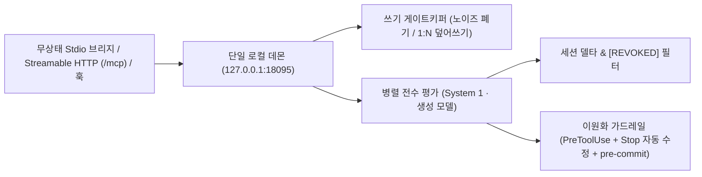

# 아키텍처 및 기술 레퍼런스

[English (ARCHITECTURE.md)](./ARCHITECTURE.md) | [README로 돌아가기](./README.ko.md)

## 1. 동작 파이프라인 & 가드레일

| 구성 요소 | 핵심 역할 | 주요 상태 · 인터페이스 |
| :--- | :--- | :--- |
| **단일 로컬 데몬** | 첫 MCP/훅 호출 시 자동 기동; SQLite(`WAL`), 로컬 `llama-server`(`:18088`), 웹 콘솔 및 포트 폴백 통합 관리 | `/mcp`, `/api/daemon/*`, SSE `/api/events`, `ports.json`, `daemon.json` |
| **쓰기 게이트키퍼** | 일회성 잡담(`transient`) 폐기, 충돌 시 `1:N` 원자적 대체, 교체·`[REVOKED]` 통지 발행 | `memories` (`core rule` / `pinned`, 계보 `superseded_by`) |
| **세션 델타 · 복구** | 기전달 규칙 재평가 생략(반복 턴 `0`회), 미전달 전수 병렬 평가(Prefix KV 캐시), 컴팩션 이후 자동 복원 | `session_sent`, `session_compacts` (`PostCompact`, `CHECKPOINT`) |
| **System 1 · 태스크 라우팅** | 판정 작업(`relevance`, `mutation`, `verify`, `calibrate`)은 출력 토큰 `0` 엔진, 합성(`consolidate`, `progress`, `taxonomy`)은 생성 모델로 분리 + `429`/`503` 쿨다운 폴백 | 7개 `EvalTask` 라우트, `eval_telemetry` 집계 |
| **저장소 격리 · 팀 룰팩** | 활동 피드(Auto-TTL)·가드레일 감사를 규칙과 분리; `.memorize/TEAM_RULES.md`는 DB 본문 미러 없이 인메모리 캐시로 직접 적재 | `project_progress`, `guardrail_logs`, `team_rule_*` 상태 |

### 이원화 가드레일 흐름 (`PreToolUse` + `Stop` + `git pre-commit`)
1. **예외 통과 · 선반영 게이트 (`PreToolUse`)**: 읽기 전용 도구와 안전한 조회 명령은 추론 `0`회로 통과하며, 당해 턴의 새 규칙 변경이 커밋되지 않았으면 `[MEMORIZE PRE-MUTATE GATE]`로 실행을 먼저 멈춥니다.
2. **쉘 명령 즉시 차단 (`PreToolUse`)**: 되돌리기 어려운 쉘 명령과 명시적 계획 검사는 실행 직전 로컬 규칙·팀 룰과 즉시 대조해 위반 시 차단합니다.
3. **편집 베이스라인 수집 (`PreToolUse`)**: 코드·문서 편집은 선반영 게이트만 통과하면 파일당 1회 턴 이전 디스크 스냅샷(`turn_pending_edits`)만 기록하고 매 편집 추론 지연을 생략합니다.
4. **턴 종료 자체 수정 (`Stop`) · 커밋 게이트**: 정상 턴 종료 시 스코프당 1회 누적 diff를 일괄 검증해 위반 시 에이전트 루프로 재진입해 스스로 수정하게 하며(무한 루프·사용자 취소 방지 포함), 커밋 시 `memorize -hook git-precommit`으로 최종 점검합니다.

---

## 2. 패키지 아키텍처

**단방향 비순환 계층(DAG)**: `domain -> infra -> inference -> modules -> transport -> app <- cmd/memorize`
*(하위 계층은 상위 계층을 임포트하지 않으며, `cmd`가 `RuntimeHooks`를 주입해 `transport/*`의 `app/*` 의존을 차단하고, 프로덕션 `git` 호출은 `internal/infra/git` 내부에만 격리합니다.)*

| 계층 | 패키지 | 역할 및 경계 |
| :--- | :--- | :--- |
| **1. Domain** | `internal/domain` | 표준 라이브러리만 사용하는 순수 도메인 모델·검증(`Fact`, `Scope`, `Progress`, `Evaluator`, `RulePack`, `Sync`, 비밀 마스킹) |
| **2. Infra** | `internal/infra/{config,sqlite,git,ssh,eventbus}` | 경로/`ports.json` 저장소, SQLite `WAL`·스키마 마이그레이션, Git 루트/커밋 조회 + 격리 `worktree` `push`, SSH 파이프*(비활성)*, SSE 변경 브로드캐스터 |
| **3. Inference** | `internal/inference/{router,providers,discovery,localmodel}` | 태스크 라우터·`429`/`503` 폴백 체인, 선언형 프로바이더(`GGUF`, `Gemini`/`Decisions`, `Jev`/`Flide`, OpenAI 호환), 카탈로그/프로빙, 로컬 `llama-server` 수명주기(`macOS`/`Linux`) |
| **4. Modules** | `internal/modules/{memory,progress,rulepack,guardrail}` | 기억 CRUD/델타/병합*(+ 게이트된 `sync_*`)*, `project_progress`·TTL, `.memorize/TEAM_RULES.md` 격리 `push`+CAS·충돌 멈춤 게이트(보호 브랜치 PR 폴백 없이 `ErrBranchProtected`), 이원화 가드레일·온보딩 |
| **5. Transport** | `internal/transport/{cli,mcp,http,dashboard}` | 플래그/데몬/포트 CLI*(+ 게이트 CLI)*, MCP 6종 도구·리소스·프롬프트 + `ScopeResolver`, 공용 HTTP/루프백·CSRF 가드*(+ 게이트 `/api/daemon/sync`)*, 6탭 HTMX SSR 웹 콘솔*(Sync UI 숨김/차단)* |
| **6. App & CLI** | `cmd/memorize`, `internal/app/localdaemon` | 진입점 조립, 단일 데몬 기동, 포트 폴백 및 버전 무중단 바이너리 핸드오버 |

- **기기 간 동기화 현황 (`v1.1`)**: 델타 로그·충돌 해결·SSH 파이프 코드는 `modules/memory/sync_*.go`, `infra/ssh/`, `infra/sqlite/sync_schema.go`, `transport/*sync*`에 구현되어 있으나 `domain.IsMemorySyncEnabled() == false`(`memory_tx_log` 미기록)로 비활성화되어 있으며 로그 컴팩션·스냅샷 부트스트랩 보강 후 활성화할 예정입니다.

---

## 3. MCP 도구 · 리소스 · 프롬프트

| 종류 | 이름 | 설명 |
| :--- | :--- | :--- |
| **Tool** | `query_project_memory` | 대상 스코프(`project:<repo>`, `global`, `personal` + `[TEAM]` 미러) 활성 규칙 평가 및 세션 델타 반환 |
| **Tool** | `commit_memory` | 단건/배치 규칙 평가(`INSERT`, `1:N` 덮어쓰기, 폐기) 및 선택적 `synced_commit` 갱신 |
| **Tool** | `verify_plan_against_memory` | 변경 전 작업 계획의 활성 로컬·팀 규칙 위반 여부 검사 |
| **Tool** | `manage_memory` | `update`, `forget`, `undo`, `consolidate`(≤180자), `purge`, `skip_onboarding`, `reset_onboarding` |
| **Tool** | `project_progress` | 시간순 프로젝트 활동 피드(`work`, `memory`, `git` 마일스톤): `record`, `update`, `list`, `sync`, `delete` |
| **Tool** | `team_rules` | `.memorize/TEAM_RULES.md` 관리: `list`, `sync`, `add`, `promote`, `update`, `remove`, `resolve_conflict`, `duplicates`, `clean_duplicates`, `set_config` |
| **Resource / Prompt** | `memorize://playbook/memory-curator` · `memory-curator` | 바이너리 내장 기억 큐레이션 플레이북 및 프롬프트 템플릿 |

---

## 4. 환경변수 · CI/CD

| 변수명 | 기본값 | 설명 |
| :--- | :--- | :--- |
| `MEMORY_DATA_DIR` / `MEMORY_DB_PATH` | `~/.memorize` · `memories.db` | 공통 데이터 루트(Windows: `%USERPROFILE%\.memorize`) 및 SQLite `WAL` 경로(`0600`) |
| `MEMORY_MODELS_DIR` | `~/.memorize/models` | 로컬 GGUF 및 `llama-server` 저장 경로(`macOS`/`Linux`) |
| `MEMORY_PROVIDER` | `gguf` *(Unix)* / `local` *(Windows)* | 활성 추론 엔진 (`gguf`, `local`, `jev` / `flide`, `gemini`) |
| `GEMINI_API_KEY` / `GEMINI_MODEL` | *(비어 있음)* / `gemini-3.5-flash-lite` | Gemini 키·모델 (`gemini-decision-1`은 `/v1beta/decisions` 라우팅) |
| `JEV_API_URL` / `JEV_MODEL` | `http://127.0.0.1:8000` / `jev-latest` | System 1 API 주소·모델 (`TYPESAFE_API_KEY` 선택) |
| `LOCAL_MODEL_URL` / `LOCAL_MODEL_NAME` | `http://127.0.0.1:11434/v1` / *(자동)* | OpenAI 호환 서버 (`Ollama`, `LM Studio`, `vLLM`) |
| `MEMORY_DAEMON_ADDR` / `MEMORY_HOOK_TIMEOUT` | `ports.json` (`:18095`) / *(매니페스트)* | 데몬 주소 수동 지정 및 훅 타임아웃(`8s`, `0`/`off`) |
| `MEMORY_INCLUDE_PERSONAL` / `MEMORY_ACCOUNT` | `0` / *(OS 사용자명)* | 프로젝트 조회 시 `personal` 포함 / 계정별 `personal` 격리(`AGY_ACCOUNT` 지원) |
| `MEMORY_GIT_SYNC` / `MEMORY_AUTO_GIT_SYNC` | `0` / `0` | Git 기준점 온보딩 및 커밋 증분 동기화 활성화 |
| `MEMORY_GUARDRAIL_FAIL_CLOSED` | `0` | `1` 설정 시 `PreToolUse`·`Stop`·`git pre-commit` 검증 오류 또는 엔진 미설정 시 차단 |

- **추가/개발용 오버라이드**: `MEMORY_DEFAULT_SCOPE`, `MEMORY_DAEMON_LOG`, `MEMORY_DISABLE_BG_DASHBOARD`, `LOCAL_GGUF_URL`/`LOCAL_GGUF_MODEL`, `LOCAL_API_KEY`/`OPENAI_API_KEY`, `FLIDE_*`, `MEMORIZE_DEV_HOTRELOAD`, `MEMORIZE_DEV_BUILD`, `MEMORIZE_RELEASE_BASE_URL`(`GITHUB_TOKEN`/`MEMORIZE_GITLAB_TOKEN`).
- **CI/CD 파이프라인**: [GitHub CI (`ci.yml`)](./.github/workflows/ci.yml), [Release (`release.yml`)](./.github/workflows/release.yml), [GitLab CI (`.gitlab-ci.yml`)](./.gitlab-ci.yml)에서 `gofmt`, 5개 타겟 `CGO_ENABLED=0 go vet`·크로스 빌드(`darwin/arm64|amd64`, `linux/arm64|amd64`, `windows/amd64`), `-race -count=1` + Windows CGO-free 테스트 검증 후 `v*.*.*` 태그 푸시 시 `SHA256SUMS` 포함 릴리스 아카이브를 자동 빌드합니다.
