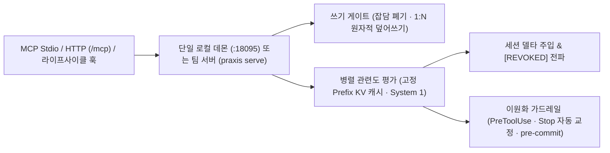

# 아키텍처 및 기술 레퍼런스

[English (ARCHITECTURE.md)](./ARCHITECTURE.md) · [README로 돌아가기](./README.ko.md) · [팀 협업 가이드](./TEAM.ko.md)

## 1. 실행 파이프라인 & 핵심 메커니즘

| 서브시스템 | 동작 원리 | 핵심 상태 · 엔드포인트 |
| :--- | :--- | :--- |
| **단일 데몬 · 팀 서버** | 첫 MCP/훅 호출 시 자동 기동하며, `praxis serve`는 SQLite `WAL` 동시 조회 풀과 SSE 실시간 푸시를 갖춘 멀티 유저 서버로 동작합니다. | `/mcp`, `/healthz`, `/api/daemon/{status,mcp,hook,export,import}`, `/api/events` |
| **쓰기 게이트 · 번들** | 일회성 대화를 버리고 상충하는 옛 규칙은 `1:N` 원자적으로 덮어쓰며, 포터블 JSON 번들(`praxis.bundle.v1`) 이관·AI 병합을 지원합니다. | `memories` (`pinned`, 대체 계보 `superseded_by`) |
| **세션 델타 · KV 캐시** | 이미 전달된 규칙은 건너뛰고(반복 턴 추론 `0`회), 미전달 규칙만 `TEAM > project:* > global > personal` 순으로 정렬 평가해 KV 캐시를 재사용합니다. | `session_sent`, `session_updates`, `session_compacts` (세션 캐시 상한 `256`개) |
| **태스크별 모델 라우팅** | 판정 작업(`relevance`, `mutation`, `verify`, `calibrate`)은 출력 토큰 `0`개 경량 엔진으로, 텍스트 합성(`consolidate`, `progress`, `taxonomy`)은 생성 모델로 분리합니다. | 7개 `EvalTask` 라우트, `eval_telemetry` 지연 집계, `429`/`503` 폴백 |
| **인증 · 4계층 격리** | SHA-256 토큰(`prx_*`)과 HMAC-SHA256 `HttpOnly` 세션·계정 스위처 쿠키로 인증하며, 팀/프로젝트 규칙은 공유하고 `global`·`personal`은 계정별로 격리합니다. | `users`, `internal_secrets`, `.praxis/TEAM_RULES.md` 인메모리 캐시 |

### 이원화 가드레일 흐름 (`PreToolUse` · `Stop` · `git pre-commit`)
1. **조회 즉시 통과 & 선반영 게이트 (`PreToolUse`)**: 읽기 전용 도구는 추론 `0`회로 통과하되, 현재 턴에 미저장된 규칙 변경이 있으면 코드 수정 전에 먼저 규칙 저장을 요구합니다.
2. **위험 쉘 · 배치 코드 사전 차단 & 승인 위임 (`PreToolUse`)**: 되돌리기 어려운 쉘 명령, 배치 코드(`REPL` · `run_workflow`), 계획 검사를 로컬·팀 규칙과 대조해 불변식 위반은 즉시 차단(`Deny`)하고, 사전 확인 조건부 규칙은 트랜스크립트 `(제안 ↔ 응답)` 쌍 확인 후 미승인 시 호스트 네이티브 승인 UI(`force_ask` · `ask`)로 위임합니다.
3. **무지연 편집 스냅샷 (`PreToolUse`)**: 일반 파일 편집은 흐름을 멈추지 않고 파일별 수정 전 원본 스냅샷(`turn_pending_edits`)만 기록합니다.
4. **턴 종료 자체 교정 (`Stop`) · 커밋 방어 · 규칙 다듬기**: 턴 종료 시 누적 diff를 스코프당 1회 검증해 재수정을 유도하고(`git-precommit` 최종 확인), 웹 콘솔 요청 시 `guardrail_logs` 차단 이력으로 기존 규칙 문안을 보강합니다.

---

## 2. 패키지 계층 경계 (단방향 비순환 DAG)

**의존 방향**: `cmd/praxis → app → transport → modules → inference → infra → domain`  
*(역방향 참조, 전달 계층의 Raw SQL 직접 실행, `internal/infra/git` 외부의 `git` 명령 호출은 `TestArchitectureBoundaries` AST 검사로 차단합니다.)*

| 계층 | 패키지 | 책임 및 경계 |
| :--- | :--- | :--- |
| **1. Domain** | `internal/domain` | 외부 패키지 의존 없는 순수 모델·정규화·보안 마스킹 (`Fact`, `Scope`, `RulePack`, `MemoryBundle`) |
| **2. Infra** | `internal/infra/{config,sqlite,git,eventbus}` | 설정 파일(`ports.json`, `remotes.json`), SQLite `WAL`·스키마·인증 저장소, 격리 `git worktree` 실행, SSE 이벤트 버스 |
| **3. Inference** | `internal/inference/{router,providers,discovery,localmodel}` | 태스크 라우터·쿨다운 폴백, `GGUF`·`Gemini`·`System 1`·OpenAI 호환 어댑터, `llama-server` 수명주기(`macOS`/`Linux`) |
| **4. Modules** | `internal/modules/{memory,progress,rulepack,guardrail}` | 기억 상태 관리·병합·번들, 활동 타임라인(`project_progress`), `.praxis/TEAM_RULES.md` 동기화, 가드레일·온보딩 |
| **5. Transport** | `internal/transport/{cli,mcp,http,dashboard}` | CLI 명령, MCP 프로토콜 브리지, 루프백 CSRF·프록시 보안 HTTP 계층, 6탭 HTMX + Alpine SSR 웹 콘솔 |
| **6. App & Entry** | `cmd/praxis`, `internal/app/localdaemon` | 단일 바이너리 진입점, 자동 데몬·팀 서버 기동 및 Graceful Shutdown, 포트 폴백·무중단 바이너리 교체 |

---

## 3. CLI & MCP 프로토콜 명세

### CLI 명령어
| 명령 | 용도 |
| :--- | :--- |
| `praxis doctor [--json]` | 바이너리·데몬·SQLite `WAL`·Git 스코프·추론 엔진·원격 연결 일괄 자가 진단 |
| `praxis daemon <subcmd>` | 로컬 데몬 제어: `status` · `start` · `stop` · `restart` · `logs` · `port [<daemon> <gguf> \| reset]` |
| `praxis serve [--addr host:port]` | 인증된 멀티 유저 공유 팀 서버 실행 (최초 기동 시 초기 `admin` 토큰 출력) |
| `praxis user <add\|list\|rotate\|disable>` | 팀 서버 계정 발급·목록·토큰 재발급·비활성화 (`--role admin\|member`) |
| `praxis connect` / `disconnect` / `switch` | 원격 팀 서버 연결(`--global` 또는 `--repo .`), 해제, 다중 계정 프로필 즉시 전환 |
| `praxis push` / `export` / `import` | 로컬→서버 이관 및 포터블 번들 입출력 (`--scope`, `--all`, `--mode exact\|merge`, `--dry-run`) |
| `praxis install\|uninstall <target>` | `cursor`(`--project`), `windsurf`, `claude-desktop`, `mcp --config <path>`, `git-hook` 비파괴 등록·해제 |

### MCP 도구 · 리소스
| 이름 | 역할 |
| :--- | :--- |
| `query_project_memory` | 스코프 우선순위(`TEAM → project:<repo> → global → personal`) 기반 활성 규칙 조회 및 세션 델타 반환 |
| `commit_memory` | 단건·배치 규칙 정제(`INSERT`, `1:N` 덮어쓰기, 노이즈 스킵) 및 선택적 `synced_commit` 기록 |
| `verify_plan_against_memory` | 실행 전 작업·명령 계획의 로컬·팀 규칙 위반 여부 사전 검증 |
| `manage_memory` | `update` · `forget` · `undo` · `consolidate`(≤180자) · `purge` · `skip_onboarding` · `reset_onboarding` |
| `project_progress` | 읽기 전용 프로젝트 활동 타임라인 관리 (`record` · `update` · `list` · `sync` · `delete`) |
| `team_rules` | `.praxis/TEAM_RULES.md` 제어 (`list` · `sync` · `add` · `promote` · `update` · `remove` · `resolve_conflict` · `duplicates` · `clean_duplicates` · `set_config`) |
| `praxis://playbook/memory-curator` | 내장 온보딩·기억 큐레이션 플레이북 리소스 및 동명 프롬프트(`memory-curator`) |

---

## 4. 주요 환경변수 & CI/CD

| 변수명 | 기본값 | 설명 |
| :--- | :--- | :--- |
| `PRAXIS_DATA_DIR` / `PRAXIS_DB_PATH` | `~/.praxis` · `memories.db` | 런타임 데이터 루트(Windows: `%USERPROFILE%\.praxis`) 및 SQLite 경로 |
| `PRAXIS_MODELS_DIR` | `~/.praxis/models` | 관리형 로컬 GGUF 모델 및 `llama-server` 저장 디렉토리 (`macOS`/`Linux`) |
| `PRAXIS_PROVIDER` | `gguf` *(Unix)* / `local` *(Win)* | 활성 추론 엔진 (`gguf` · `gemini` · `jev`/`flide` · `local`) |
| `GEMINI_API_KEY` / `GEMINI_MODEL` | *(비어 있음)* / `gemini-3.5-flash-lite` | Gemini API 키 및 기본 모델 (`gemini-decision-1` 선택 시 `/v1beta/decisions` 사용) |
| `LOCAL_MODEL_URL` / `LOCAL_MODEL_NAME` | `http://127.0.0.1:11434/v1` / *(자동)* | OpenAI 호환 로컬 엔드포인트 (`Ollama`, `LM Studio`, `vLLM`) |
| `JEV_API_URL` / `JEV_MODEL` | `http://127.0.0.1:8000` / `jev-latest` | System 1 판정 엔진 주소 및 모델 (`TYPESAFE_API_KEY` 선택) |
| `PRAXIS_REMOTE_URL` / `PRAXIS_REMOTE_TOKEN` | *(비어 있음)* | `remotes.json`보다 우선 적용되는 원격 팀 서버 URL 및 Bearer 토큰 |
| `PRAXIS_DAEMON_ADDR` / `PRAXIS_HOOK_TIMEOUT` | `:18095` / *(매니페스트 기준)* | 데몬 바인딩 주소 수동 지정 및 훅 타임아웃(`8s`, 비활성화 `0`/`off`) |
| `PRAXIS_INCLUDE_PERSONAL` / `PRAXIS_ACCOUNT` | `0` / *(OS 사용자)* | 프로젝트 조회 시 `personal` 포함 여부 및 계정 키 지정 (`AGY_ACCOUNT` 호환) |
| `PRAXIS_GIT_SYNC` / `PRAXIS_GUARDRAIL_FAIL_CLOSED` | `0` / `0` | Git 커밋 증분 규칙 동기화 활성화 / 엔진 미설정·오류 시 엄격 차단(`1`) |

- **CI/CD**: [ci.yml](./.github/workflows/ci.yml) · [release.yml](./.github/workflows/release.yml) · [.gitlab-ci.yml](./.gitlab-ci.yml)에서 Go `1.26` 기준 `gofmt`, `staticcheck`, `deadcode`, 5개 타겟 `CGO_ENABLED=0` 정적 빌드(`darwin/arm64|amd64`, `linux/arm64|amd64`, `windows/amd64`) 및 `-race -count=1` 테스트 통과 후 `SHA256SUMS` 포함 릴리스 아카이브를 발행합니다.
