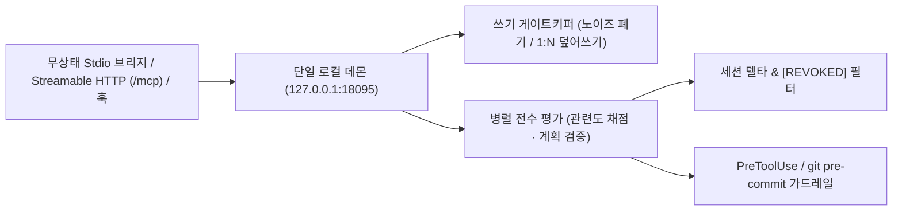

# 아키텍처 및 기술 레퍼런스

[English (ARCHITECTURE.md)](./ARCHITECTURE.md) | [README로 돌아가기](./README.ko.md)

## 1. 내부 동작 파이프라인

### 1.1 단일 로컬 데몬 (`127.0.0.1:18095`)
- **자동 기동 및 통합 소유**: 첫 `stdio` 또는 훅 호출 시 자동 기동되어 SQLite(`WAL`), `llama-server` GGUF 런타임(기본 `:18088`), SSE 웹 콘솔, `/mcp`, `/api/daemon/mcp`, `/api/daemon/hook`, `/api/daemon/port`를 통합 관리합니다.
- **포트 관리 및 자동 폴백**: 설정 포트는 DB와 같은 경로의 `ports.json`에 저장하고 실제 바인딩 주소는 `daemon.json`에 게시합니다. 포트 충돌 시 빈 루프백 포트로 자동 폴백하며 CLI·훅·열린 `stdio` 브리지가 새 주소를 즉시 추적합니다.
- **핫리로드 및 실행 규약**: 업그레이드된 버전 바이너리를 무중단 교체하되(`CWD` 바이너리 감시 및 디스크 템플릿·에셋 라이브 리로드는 `MEMORIZE_DEV_HOTRELOAD=1`일 때만 허용), 매니페스트 기반 동적 `timeout_ms`를 적용하고(`git pre-commit`은 무제한) 정적 `AGENTS.md`/`CLAUDE.md` 대신 MCP `serverInstructions`·훅·SQLite 규칙만으로 동작합니다.

### 1.2 쓰기 게이트키퍼 & 계보 관리
- **노이즈 분류·폐기**: 후보 기억을 `invariant` · `rule` · `preference` · `transient`로 분류해 일회성 노이즈를 버립니다.
- **원자적 `1:N` 덮어쓰기**: 배타적 충돌이 감지되면 단일 트랜잭션으로 기존 규칙을 `active=0, superseded_by`로 비활성화합니다.
- **세션 무효화 통지**: 후속 턴에 `*(Replaces: ...)*`, `*(Updated #id ...)*`, `[REVOKED #id]`를 주입해 옛 지시 회귀를 차단합니다.

### 1.3 세션 델타 · 전수 병렬 평가 · 컴팩션 자동 복구
- **세션 선필터 & KV 캐시**: 평가 전 `session_sent`로 이미 전달된 ID를 걸러 변경 없는 반복 턴은 추론 `0`회로 통과시키고, 미전달 규칙 100%를 `고정 Prefix + 동적 Suffix` 병렬 청크로 평가해 `TOP-K` 누락 없이 KV 캐시 히트와 최소 메인 컨텍스트(`System 2`)를 동시에 달성합니다.
- **컴팩션 자동 복구**: Claude Code의 `PostCompact`/`SessionStart(source="compact")` 및 Antigravity `transcriptPath`의 증분 `CHECKPOINT` 감지(`session_compacts`) 시 `session_sent`를 자동 초기화하고, 압축 요약을 관련도 평가에 반영해 필요한 규칙을 즉시 재주입합니다.

### 1.4 직관(`System 1`) 0-토큰 판정 · 태스크 라우팅 · 텔레메트리
- **직관(`System 1`) & 기능별 라우팅**: 게이트키핑·관련도·가드레일(`relevance`, `write_gate`, `verify`, `calibrate`)은 `Jev / Flide` 및 `gemini-decision-1`(`v1beta/decisions`, 출력 토큰 `0`) 단일 패스로 처리하고, 텍스트 합성(`consolidate`, `progress`, `taxonomy`)만 컴패니언 생성 모델(`gen_provider`/`gen_model`)로 분리 라우팅합니다. *(최초 설치 후 로컬 GGUF 다운로드 또는 API/URL 엔진 설정 완료 시 활성화)*
- **런타임 텔레메트리**: `eval_telemetry`에 7개 태스크·엔진별 호출 수, 평균/P95/누적 지연(ms), 타임아웃·오류를 집계해 추론 엔진 탭 상단 접이식 텔레메트리 패널에 표시합니다.

### 1.5 저장소 격리 (`project_progress` · 라이브 세션 · `guardrail_logs`)
- **최소주의 원칙**: 하드코딩 단어 사전, 문자열 스크래핑, 커스텀 DOM 모핑, 청소 타이머를 두지 않고 명시적·구조적 데이터만 유지합니다.
- **영구 진행판 (`project_progress`) & 인메모리 라이브 세션**: `memories`와 테이블을 분리해 규칙 오탐을 막고, 실시간 턴·툴 상태와 훅 누적 지연 시간은 90초 TTL 인메모리 `LiveSession` 레지스트리(`GET /api/live-sessions`, `event: live` SSE)로만 1줄 표시합니다.
- **가드레일 로그 & SSE**: `guardrail_logs.elapsed_ms`에 검사 시간을 기록하고, 영구 도메인은 `GET /api/events`(`event: change` SSE)로 부분 갱신하며 Auto-TTL(`0`=영구) 및 `PASS` 우선/워터마크 안전 정리를 지원합니다.

---

## 2. MCP 도구, 리소스 및 프롬프트 명세

| 종류 | 이름 | 설명 |
| :--- | :--- | :--- |
| **Tool** | `query_project_memory` | 대상 스코프(`project:<repo>`, `global`, `personal`) 활성 기억 전수 평가 + 세션 델타 |
| **Tool** | `commit_memory` | 단건/다건 후보 평가(저장·`1:N` 덮어쓰기·폐기) + Git `synced_commit` 갱신 |
| **Tool** | `verify_plan_against_memory` | 코드 변경 전 작업 계획의 활성 규칙 위반 여부 검사 |
| **Tool** | `manage_memory` | `update`, `forget`, `undo`, `consolidate`, `purge`, `skip_onboarding`, `reset_onboarding` |
| **Tool** | `project_progress` | 분리된 3칸 진행 보드(`planned` / `in_progress` / `blocked` / `done`)·기억/Git 동기화: `record`, `update`, `list`, `sync`, `delete` |
| **Resource** | `memorize://playbook/memory-curator` | 바이너리 내장 운영 플레이북 |
| **Prompt** | `memory-curator` | 고순도 상태 규칙 정제용 프롬프트 템플릿 |

---

## 3. 환경변수 레퍼런스

| 변수명 | 기본값 | 설명 |
| :--- | :--- | :--- |
| `MEMORY_DATA_DIR` | `~/.memorize` | `memories.db`, `bin/`, `models/`, `ports.json`, `daemon.json` 공통 기본 루트 (Windows: `%USERPROFILE%\.memorize`) |
| `MEMORY_DB_PATH` | `~/.memorize/memories.db` | SQLite WAL DB 경로 (`0600` 권한) |
| `MEMORY_MODELS_DIR` | `~/.memorize/models` | 로컬 GGUF 및 `llama-server` 저장 경로 (`macOS`/`Linux`) |
| `MEMORY_PROVIDER` | `gguf` *(macOS/Linux)* / `local` *(Windows)* | `gguf`, `local`, `jev` / `flide`, `gemini` |
| `GEMINI_API_KEY` / `GEMINI_MODEL` | *(비어 있음)* / `gemini-3.5-flash-lite` | Gemini 키·모델 (`gemini-decision-1`은 `/v1beta/decisions` 라우팅) |
| `JEV_API_URL` / `JEV_MODEL` | `http://127.0.0.1:8000` / `jev-latest` | System 1 API (`OmniJev/Flide` 또는 TypeSafe Cloud; `TYPESAFE_API_KEY` 선택) |
| `LOCAL_MODEL_URL` / `LOCAL_MODEL_NAME` | `http://127.0.0.1:11434/v1` / *(자동)* | OpenAI 호환 서버 (`Ollama`, `LM Studio`, `vLLM`; `LOCAL_API_KEY` 선택) |
| `MEMORY_DAEMON_ADDR` | *(미설정 시 `ports.json` / 기본 `127.0.0.1:18095`)* | 데몬 및 웹 콘솔 주소 수동 고정 (`memorize daemon port`보다 우선) |
| `MEMORY_HOOK_TIMEOUT` | *(매니페스트 기준)* | 훅 제한 시간 오버라이드 (`8s`, `0`/`off` 무제한) |
| `MEMORY_INCLUDE_PERSONAL` | `0` | `1` 설정 시 프로젝트 조회에 `personal` 기억 포함 |
| `MEMORY_DISABLE_BG_DASHBOARD` | `0` | `1` 설정 시 독립 인라인 MCP `stdio` 모드 |
| `MEMORY_GUARDRAIL_FAIL_CLOSED` | `0` | `1` 설정 시 PreToolUse·가드레일 검증 실패/엔진 미설정 상태에서 도구 실행을 차단 |
| `MEMORIZE_DEV_HOTRELOAD` | `0` | 개발용 옵트인 (`1` 설정 시 `CWD` 바이너리 감시 및 디스크 템플릿/에셋 라이브 리로드 활성화) |
| `MEMORIZE_DEV_BUILD` | `0` | `run-memorize.sh`에서 `1` 설정 시 릴리스 SHA256 다운로드 대신 로컬 Go 소스 빌드 폴백 허용 |
| `MEMORIZE_RELEASE_BASE_URL` | *(`plugin.json` 기준)* | 커스텀 미러 URL (`GITHUB_TOKEN` / `MEMORIZE_GITLAB_TOKEN` 지원) |

---

## 4. CI/CD 자동 릴리스

- **파이프라인 정의**: [GitHub Actions (`.github/workflows/ci-release.yml`)](./.github/workflows/ci-release.yml) · [GitLab CI (`.gitlab-ci.yml`)](./.gitlab-ci.yml)
- **자동 테스트 검증**: 멀티 OS `go vet` + Unix(`ubuntu-latest`, `macos-latest`) `go test -v -race -count=1 ./...` + Windows(`windows-latest`) `CGO_ENABLED=0 go test -v -count=1 ./...`
- **릴리스 아티팩트 (`v*.*.*` 태그)**: 5개 타겟(`darwin/arm64`, `darwin/amd64`, `linux/arm64`, `linux/amd64`, `windows/amd64`) `CGO_ENABLED=0` 아카이브 및 `SHA256SUMS` 자동 생성·배포
