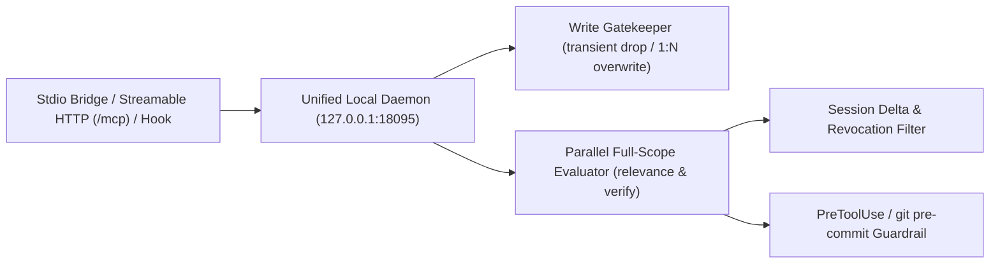

# Architecture & Technical Reference

[한국어 (ARCHITECTURE.ko.md)](./ARCHITECTURE.ko.md) | [Back to README](./README.md)

## 1. Execution Pipeline

### 1.1 Unified Local Daemon (`127.0.0.1:18095`)
- **Auto-Startup & Ownership**: Auto-spawned on the first `stdio` or hook invocation; owns SQLite (`WAL`), `llama-server` GGUF runtime (default `:18088`), the SSE Web Console, `/mcp`, `/api/daemon/mcp`, `/api/daemon/hook`, and `/api/daemon/port`.
- **Port Persistence & Auto-Fallback**: Saves preferred ports to `ports.json` beside the DB and publishes the active bind address to `daemon.json`; port changes (`memorize daemon port` or the Web Console) and busy-port fallbacks are discovered automatically by CLI commands, hooks, and open `stdio` bridges.
- **Reload Safety & Hook Budgets**: Hot-reloads versioned binary upgrades cleanly without breaking active chats (restricting CWD binary/live-asset hot-reload to `MEMORIZE_DEV_HOTRELOAD=1`), applies dynamic manifest-derived `timeout_ms` budgets (`git pre-commit` runs unbounded), and ships zero static `AGENTS.md`/`CLAUDE.md` rule files—driving behavior via MCP `serverInstructions`, hooks, and scoped SQLite rules.

### 1.2 Write Gatekeeper & Lineage
- **Noise Filtering**: Classifies candidate facts into `invariant`, `rule`, `preference`, or `transient`, dropping ephemeral chatter.
- **Atomic `1:N` Replacement**: On exclusive conflicts, retires prior rules atomically inside one transaction (`active=0, superseded_by=<new_id>`).
- **Revocation Notices**: Injects one-time `*(Replaces: ...)*`, `*(Updated #id ...)*`, and `[REVOKED #id]` notices so active sessions stay aligned.

### 1.3 Session Delta, Parallel Full Eval & Compaction Recovery
- **Pre-Filter & Static-Prefix KV Cache**: Excludes already-delivered IDs via `session_sent` before scoring (`0` inference calls on unchanged repeat turns), and evaluates `100%` of unsent rules in parallel chunks (`static prefix + dynamic suffix`)—avoiding `TOP-K` blind spots while maximizing KV-cache reuse and keeping `System 2` coding LLM context minimal.
- **Automatic Compaction Recovery**: Detects compaction via Claude Code (`PostCompact`, `SessionStart(source="compact")`) and Antigravity (`transcriptPath` incremental `CHECKPOINT` scanning via `session_compacts`), clearing stale `session_sent` rows and feeding the compacted summary back into scoring.

### 1.4 Intuitive `System 1` Scoring, Task Routing & Telemetry
- **Intuitive `System 1` & Companion Generation**: Routes single-pass `0`-output-token judgment tasks (`relevance`, `write_gate`, `verify`, `calibrate`) to `Jev / Flide` or `gemini-decision-1` (`/v1beta/decisions`), while isolating heavy text synthesis (`consolidate`, `progress`, `taxonomy`) on `gen_provider`/`gen_model`. *(Requires an active inference engine—Local GGUF download or API/URL—after initial install.)*
- **Runtime Telemetry**: Persists per-task/per-engine counts, average & P95 latency, cumulative ms, and timeout/error totals in `eval_telemetry`, surfaced in the collapsible telemetry bar on the Engines tab.

### 1.5 Isolated Stores (`project_progress`, Live Sessions & `guardrail_logs`)
- **Minimalism & Zero-Heuristics**: Avoids hardcoded keyword lists, string scraping, custom DOM morphers, and background cleanup timers.
- **Persistent Work Board & Ephemeral Live Sessions**: Separates `project_progress` (strictly explicit/Git/manual records) from `memories` to prevent false rule triggers, while active turn/tool heartbeats and cumulative hook timing live in an in-memory 90s-TTL `LiveSession` registry (`GET /api/live-sessions`, `event: live` SSE).
- **Guardrail Audit & SSE Updates**: Tracks check latency in `guardrail_logs.elapsed_ms`, streams `event: change` partial UI swaps via `GET /api/events`, and supports Auto-TTL retention (`0` = Forever) plus PASS-first / watermark-safe cleanup.

---

## 2. MCP Tools, Resources & Prompts

| Kind | Name | Purpose |
| :--- | :--- | :--- |
| **Tool** | `query_project_memory` | Full-scope active rule evaluation (`project:<repo>`, `global`, `personal`) + session delta |
| **Tool** | `commit_memory` | Single/batch candidate evaluation + Git `synced_commit` update |
| **Tool** | `verify_plan_against_memory` | Pre-execution compliance check against active rules |
| **Tool** | `manage_memory` | `update`, `forget`, `undo`, `consolidate`, `purge`, `skip_onboarding`, `reset_onboarding` |
| **Tool** | `project_progress` | Separated 3-lane work (`planned` / `in_progress` / `blocked` / `done`) & Git sync: `record`, `update`, `list`, `sync`, `delete` |
| **Resource** | `memorize://playbook/memory-curator` | Embedded operating playbook |
| **Prompt** | `memory-curator` | On-demand memory curation prompt |

---

## 3. Environment Variables

| Variable | Default | Description |
| :--- | :--- | :--- |
| `MEMORY_DATA_DIR` | `~/.memorize` | Shared root directory for `memories.db`, `bin/`, `models/`, `ports.json`, and `daemon.json` (`%USERPROFILE%\.memorize` on Windows) |
| `MEMORY_DB_PATH` | `~/.memorize/memories.db` | SQLite WAL DB path (`0600`) |
| `MEMORY_MODELS_DIR` | `~/.memorize/models` | Local GGUF & `llama-server` directory (`macOS`/`Linux`) |
| `MEMORY_PROVIDER` | `gguf` *(macOS/Linux)* / `local` *(Windows)* | `gguf`, `local`, `jev` / `flide`, or `gemini` |
| `GEMINI_API_KEY` / `GEMINI_MODEL` | *(empty)* / `gemini-3.5-flash-lite` | Gemini API key & model (`gemini-decision-1` routes decision tasks to `/v1beta/decisions`) |
| `JEV_API_URL` / `JEV_MODEL` | `http://127.0.0.1:8000` / `jev-latest` | System 1 API (`OmniJev/Flide` or TypeSafe Cloud; `TYPESAFE_API_KEY` optional locally) |
| `LOCAL_MODEL_URL` / `LOCAL_MODEL_NAME` | `http://127.0.0.1:11434/v1` / *(auto)* | OpenAI-compatible server (`Ollama`, `LM Studio`, `vLLM`; `LOCAL_API_KEY` optional) |
| `MEMORY_DAEMON_ADDR` | *(default `127.0.0.1:18095` or `ports.json`)* | Explicit daemon & dashboard bind address override |
| `MEMORY_HOOK_TIMEOUT` | *(from manifest)* | Hook deadline override (`8s`, `0`/`off` for unlimited) |
| `MEMORY_INCLUDE_PERSONAL` | `0` | Set `1` to include `personal` memories inside project queries |
| `MEMORY_DISABLE_BG_DASHBOARD` | `0` | Set `1` for isolated inline MCP `stdio` mode |
| `MEMORY_GUARDRAIL_FAIL_CLOSED` | `0` | Set `1` to deny tool execution when PreToolUse / guardrail verification fails or has no active engine |
| `MEMORIZE_DEV_HOTRELOAD` | `0` | Opt-in dev mode (`1` enables CWD binary watching and live dashboard template/asset reload from disk) |
| `MEMORIZE_DEV_BUILD` | `0` | Set `1` in `run-memorize.sh` to permit `go build` from local source instead of strict release archive SHA256 download |
| `MEMORIZE_RELEASE_BASE_URL` | *(from `plugin.json`)* | Mirror URL; `GITHUB_TOKEN` / `MEMORIZE_GITLAB_TOKEN` for private releases |

---

## 4. CI/CD Release Automation

- **Pipelines**: [GitHub Actions (`.github/workflows/ci-release.yml`)](./.github/workflows/ci-release.yml) · [GitLab CI (`.gitlab-ci.yml`)](./.gitlab-ci.yml)
- **Automated Test Matrix**: Cross-OS `go vet`, Unix `go test -v -race -count=1 ./...` (`ubuntu-latest`, `macos-latest`), and Windows `CGO_ENABLED=0 go test -v -count=1 ./...` (`windows-latest`)
- **Release Artifacts (`v*.*.*` tags)**: Cross-compiles `CGO_ENABLED=0` archives (`darwin/arm64`, `darwin/amd64`, `linux/arm64`, `linux/amd64`, `windows/amd64`) plus `SHA256SUMS` automatically
