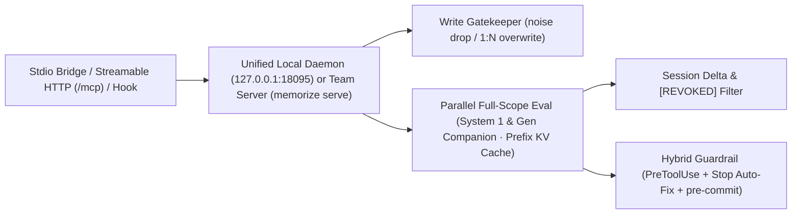

# Architecture & Technical Reference

[한국어 (ARCHITECTURE.ko.md)](./ARCHITECTURE.ko.md) | [Back to README](./README.md)

## 1. Execution Pipeline & Guardrails

| Component | Responsibility | State / Interface |
| :--- | :--- | :--- |
| **Unified Daemon & Team Server** | Local daemon auto-spawns on first MCP/hook call; `memorize serve` exposes authenticated multi-user mode (`0.0.0.0:18095`) with concurrent SQLite `WAL` read pooling (`MaxOpenConns=4`, `_txlock=immediate`, `busy_timeout=10000`), unified `SIGINT`/`SIGTERM` graceful `Shutdown`, unauthenticated `GET`/`HEAD /healthz` probe, and SSE domain push | `/mcp`, `/healthz`, `/api/daemon/{status,mcp,hook,export,import}`, SSE `/api/events`, `ports.json`, `daemon.json`, `remotes.json` |
| **Auth & 4-Tier Scope Isolation** | SHA-256 Bearer tokens (`mem_*`), HMAC-SHA256 `HttpOnly` session (`memorize_session`) & multi-account switcher (`memorize_accounts`, up to 10 accounts, DB `active=1` + `token_hint` revalidation) cookies backed by `internal_secrets`, per-IP `/login` & switcher rate limiting, trusted proxy header guard, and `TEAM > project:* > global[per-account] > personal` isolation & prefix sort | `users`, `internal_secrets`, `user_repo_sync`, `ClientHookContext` |
| **Write Gatekeeper & Bundles** | Filters chatter (`transient`), atomically retires superseded rules (`1:N`), emits replacement/`[REVOKED]` notices, and supports portable `memorize.bundle.v1` `ExportBundle` / `ImportBundle` (`exact` 1:1 migration or 20-item chunked AI `merge` with `dry_run`) | `memories` (`core rule` / `pinned`, lineage `superseded_by`) |
| **Session Delta & Bounded Caches** | Skips already-delivered facts (`0` eval on repeat turns), evaluates unsent rules in parallel (`TEAM > project:* > global > personal` KV prefix order), bounds in-memory session/rulepack caches (`256` entries / `6h` idle), periodically sweeps transient tables, and auto-restores after compaction | `session_sent`, `session_updates`, `session_compacts`, `turn_state` |
| **System 1 & Routing** | Routes judgment tasks (`relevance`, `mutation`, `verify`, `calibrate`) to 0-output-token engines and synthesis (`consolidate`, `progress`, `taxonomy`) to companion gen models with `429`/`503` fallback | 7 `EvalTask` routes, `eval_telemetry` metrics |
| **Isolated Stores & Team Pack** | Separates activity history (Auto-TTL) and guardrail audits from rules; parses `.memorize/TEAM_RULES.md` into an account/scope-isolated in-memory cache without a SQLite rule-body mirror | `project_progress`, `guardrail_logs`, `team_rule_*` states |

### Hybrid Guardrail Flow (`PreToolUse` + `Stop` + `git pre-commit`)
1. **Exempt & Pre-Mutate Gate (`PreToolUse`)**: Read-only tools and safe read-only commands pass with `0` inference calls; if the current prompt introduced an uncommitted rule change, mutations pause immediately (`[MEMORIZE PRE-MUTATE GATE]`) until memory is updated.
2. **Immediate Shell Block (`PreToolUse`)**: Irreversible shell commands and explicit plan checks verify upfront against active local and team rules before execution.
3. **Turn Baseline Capture (`PreToolUse`)**: Interactive file edits pass without per-edit inference stalls after the pre-mutate gate, snapshotting each file's pre-turn disk baseline once into `turn_pending_edits`.
4. **Turn-End Auto-Fix (`Stop`) & Commit Gate**: On normal turn completion, cumulative per-file turn diffs (chunked within engine input token budgets) are verified once per scope; violations re-enter the agent loop for self-correction (guarding against re-entry loops and cancellations), backed by `memorize -hook git-precommit` on staged commits.

---

## 2. Package Layering

**Dependency Direction (Acyclic DAG)**: `cmd/memorize → app → transport → modules → inference → infra → domain`  
*(Dependencies flow strictly downward; Git execution and SQLite access stay encapsulated within their owning layers.)*

| Layer | Packages | Role & Boundary |
| :--- | :--- | :--- |
| **1. Domain** | `internal/domain` | Stdlib-only core models & validation (`Fact`, `Scope`, `AuthPrincipal`, `MemoryBundle`, `FactPriorityRank`, `Progress`, `Evaluator`, `RulePack`, secret redaction) |
| **2. Infra** | `internal/infra/{config,sqlite,git,eventbus}` | Paths/`ports.json`/`remotes.json` (`profiles` cache), SQLite `WAL` pool/indexes/migrations/auth/switcher cookies/transient sweeps, Git root/commit inspection + isolated `worktree` `push`, SSE domain broadcaster with clean `Close()` |
| **3. Inference** | `internal/inference/{router,providers,discovery,localmodel}` | Per-task router & `429`/`503` cooldown fallback, declarative provider adapters (`GGUF`, `Gemini`/`Decisions`, `Jev`/`Flide`, OpenAI-compatible), preset probing, local `llama-server` lifecycle (`macOS`/`Linux`) |
| **4. Modules** | `internal/modules/{memory,progress,rulepack,guardrail}` | Memory CRUD/deltas/consolidation/portable `ExportBundle`·`ImportBundle`/bounded caches, `project_progress` & TTL, `.memorize/TEAM_RULES.md` isolated `push` + CAS & conflict pause gate (`ErrBranchProtected` without PR fallback), Hybrid `PreToolUse`+`Stop`+`pre-commit` guardrails & onboarding |
| **5. Transport** | `internal/transport/{cli,mcp,http,dashboard}` | CLI (`daemon`, `serve`, `user`, `connect`, `disconnect`, `switch`, `push`, `export`, `import`), 6 MCP tools/resource/prompt + `ScopeResolver`, HTTP mux/`/healthz`/auth/proxy/CSRF guards + thin-client bridge, 6-tab HTMX SSR Web Console (including `/login`, **Switch Account**, **Accounts**, **Remote Servers**, and **Export / Import**) |
| **6. App & CLI** | `cmd/memorize`, `internal/app/localdaemon` | Minimal entrypoint wiring, unified local daemon & authenticated team server lifecycle, `SIGINT`/`SIGTERM` graceful shutdown, port fallback, versioned binary handover, and `TestArchitectureBoundaries` DAG/AST guard |

---

## 3. MCP Tools, Resources & Prompts

| Kind | Name | Purpose |
| :--- | :--- | :--- |
| **Tool** | `query_project_memory` | Evaluate active rules (`TEAM` → `project:<repo>` → `global` → `personal`) with session delta |
| **Tool** | `commit_memory` | Single/batch rule evaluation (`INSERT`, `1:N` overwrite, drop) + optional `synced_commit` update |
| **Tool** | `verify_plan_against_memory` | Pre-execution compliance check against active local and team rules |
| **Tool** | `manage_memory` | `update`, `forget`, `undo`, `consolidate` (`<= 180` chars), `purge`, `skip_onboarding`, `reset_onboarding` |
| **Tool** | `project_progress` | Chronological project activity feed (`work`, `memory`, `git` milestones): `record`, `update`, `list`, `sync`, `delete` |
| **Tool** | `team_rules` | `.memorize/TEAM_RULES.md` workflow: `list`, `sync`, `add`, `promote`, `update`, `remove`, `resolve_conflict`, `duplicates`, `clean_duplicates`, `set_config` |
| **Resource / Prompt** | `memorize://playbook/memory-curator` · `memory-curator` | Embedded memory curation playbook and prompt template |

---

## 4. Environment Variables & CI/CD

| Variable | Default | Description |
| :--- | :--- | :--- |
| `MEMORY_DATA_DIR` / `MEMORY_DB_PATH` | `~/.memorize` · `memories.db` | Shared data root (`%USERPROFILE%\.memorize` on Windows) and SQLite `WAL` path (`0600`) |
| `MEMORY_MODELS_DIR` | `~/.memorize/models` | Local GGUF models & `llama-server` directory (`macOS`/`Linux`) |
| `MEMORY_REMOTE_URL` / `MEMORY_REMOTE_TOKEN` | *(empty)* | Explicit thin-client override targeting a Team Server URL and Bearer token (overrides `remotes.json`) |
| `MEMORY_PROVIDER` | `gguf` *(Unix)* / `local` *(Windows)* | Active engine: `gguf`, `local`, `jev` / `flide`, or `gemini` |
| `GEMINI_API_KEY` / `GEMINI_MODEL` | *(empty)* / `gemini-3.5-flash-lite` | Gemini key & model (`gemini-decision-1` uses `/v1beta/decisions`) |
| `JEV_API_URL` / `JEV_MODEL` | `http://127.0.0.1:8000` / `jev-latest` | System 1 API endpoint/model (`TYPESAFE_API_KEY` for cloud) |
| `LOCAL_MODEL_URL` / `LOCAL_MODEL_NAME` | `http://127.0.0.1:11434/v1` / *(auto)* | OpenAI-compatible local server (`Ollama`, `LM Studio`, `vLLM`) |
| `MEMORY_DAEMON_ADDR` / `MEMORY_HOOK_TIMEOUT` | `ports.json` (`:18095`) / *(manifest)* | Explicit daemon address override and hook timeout (`8s`, `0`/`off`) |
| `MEMORY_INCLUDE_PERSONAL` / `MEMORY_ACCOUNT` | `0` / *(OS user)* | Overlay `personal` memories in projects; isolate `personal` scope by user (`AGY_ACCOUNT` alias) |
| `MEMORY_GIT_SYNC` / `MEMORY_AUTO_GIT_SYNC` | `0` / `0` | Enable manual/hook Git baseline onboarding & incremental commit rule sync |
| `MEMORY_GUARDRAIL_FAIL_CLOSED` | `0` | Set `1` to block on `PreToolUse` / `Stop` / `git pre-commit` verification errors or missing engines |

- **Additional Overrides**: `MEMORY_BOOTSTRAP_ACCOUNT`, `MEMORY_BOOTSTRAP_TOKEN`, `MEMORY_DEFAULT_SCOPE`, `MEMORY_DAEMON_LOG`, `MEMORY_DISABLE_BG_DASHBOARD`, `LOCAL_GGUF_URL`/`LOCAL_GGUF_MODEL`, `LOCAL_API_KEY`/`OPENAI_API_KEY`, `FLIDE_*`, `MEMORIZE_DEV_HOTRELOAD`, `MEMORIZE_DEV_BUILD`, `MEMORIZE_RELEASE_BASE_URL` (`GITHUB_TOKEN`/`MEMORIZE_GITLAB_TOKEN`).
- **CI/CD Pipelines**: [GitHub CI (`ci.yml`)](./.github/workflows/ci.yml), [Release (`release.yml`)](./.github/workflows/release.yml), and [GitLab CI (`.gitlab-ci.yml`)](./.gitlab-ci.yml) run on Go `1.26` to verify `gofmt`, `staticcheck`, `deadcode`, 5-target `CGO_ENABLED=0 go vet` + cross-builds (`darwin/arm64|amd64`, `linux/arm64|amd64`, `windows/amd64`), `-race -count=1` tests (including `TestArchitectureBoundaries`) + Windows CGO-free tests, and publish `SHA256SUMS` archives on `v*.*.*` tags.
