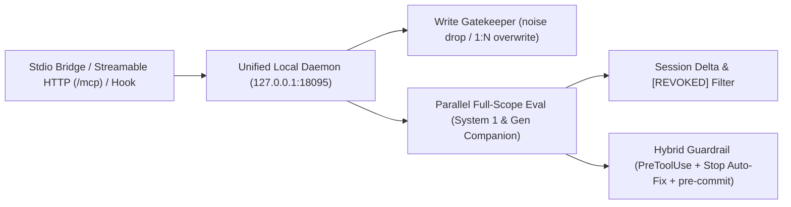

# Architecture & Technical Reference

[한국어 (ARCHITECTURE.ko.md)](./ARCHITECTURE.ko.md) | [Back to README](./README.md)

## 1. Execution Pipeline & Guardrails

| Component | Responsibility | State / Interface |
| :--- | :--- | :--- |
| **Unified Daemon** | Auto-spawns on first MCP/hook call; owns SQLite (`WAL`), local `llama-server` (`:18088`), Web Console, and port fallback | `/mcp`, `/api/daemon/*`, SSE `/api/events`, `ports.json`, `daemon.json` |
| **Write Gatekeeper** | Filters chatter (`transient`), atomically retires superseded rules (`1:N`), and emits replacement/`[REVOKED]` notices | `memories` (`core rule` / `pinned`, lineage `superseded_by`) |
| **Session Delta & Recovery** | Skips already-delivered facts (`0` eval on repeat turns), evaluates unsent rules in parallel (`KV`-cached static prefix), and auto-restores after compaction | `session_sent`, `session_compacts` (`PostCompact`, `CHECKPOINT`) |
| **System 1 & Routing** | Routes judgment tasks (`relevance`, `mutation`, `verify`, `calibrate`) to 0-output-token engines and synthesis (`consolidate`, `progress`, `taxonomy`) to companion gen models with `429`/`503` fallback | 7 `EvalTask` routes, `eval_telemetry` metrics |
| **Isolated Stores & Team Pack** | Separates activity history (Auto-TTL) and guardrail audits from rules; parses `.memorize/TEAM_RULES.md` into an in-memory cache without a SQLite rule-body mirror | `project_progress`, `guardrail_logs`, `team_rule_*` states |

### Hybrid Guardrail Flow (`PreToolUse` + `Stop` + `git pre-commit`)
1. **Exempt & Pre-Mutate Gate (`PreToolUse`)**: Read-only tools and safe read-only commands pass with `0` inference calls; if the current prompt introduced an uncommitted rule change, mutations pause immediately (`[MEMORIZE PRE-MUTATE GATE]`) until memory is updated.
2. **Immediate Shell Block (`PreToolUse`)**: Irreversible shell commands and explicit plan checks verify upfront against active local and team rules before execution.
3. **Turn Baseline Capture (`PreToolUse`)**: Interactive file edits pass without per-edit inference stalls after the pre-mutate gate, snapshotting each file's pre-turn disk baseline once into `turn_pending_edits`.
4. **Turn-End Auto-Fix (`Stop`) & Commit Gate**: On normal turn completion, cumulative per-file turn diffs are verified once per scope; violations re-enter the agent loop for self-correction (guarding against re-entry loops and cancellations), backed by `memorize -hook git-precommit` on staged commits.

---

## 2. Package Layering

**Strict Acyclic DAG**: `domain -> infra -> inference -> modules -> transport -> app <- cmd/memorize`
*(Lower layers never import higher layers; `cmd` injects `RuntimeHooks` into `transport/cli` so `transport/*` never imports `app/*`; production `git` execution stays confined to `internal/infra/git`.)*

| Layer | Packages | Role & Boundary |
| :--- | :--- | :--- |
| **1. Domain** | `internal/domain` | Stdlib-only core models & validation (`Fact`, `Scope`, `Progress`, `Evaluator`, `RulePack`, `Sync`, secret redaction) |
| **2. Infra** | `internal/infra/{config,sqlite,git,ssh,eventbus}` | Paths/`ports.json` store, SQLite `WAL` & migrations, Git root/commit inspection + isolated `worktree` `push`, hardened SSH pipe *(dormant)*, SSE domain broadcaster |
| **3. Inference** | `internal/inference/{router,providers,discovery,localmodel}` | Per-task router & `429`/`503` cooldown fallback, declarative provider adapters (`GGUF`, `Gemini`/`Decisions`, `Jev`/`Flide`, OpenAI-compatible), preset probing, local `llama-server` lifecycle (`macOS`/`Linux`) |
| **4. Modules** | `internal/modules/{memory,progress,rulepack,guardrail}` | Memory CRUD/deltas/consolidation *(+ gated `sync_*`)*, `project_progress` & TTL, `.memorize/TEAM_RULES.md` isolated `push` + CAS & conflict pause gate (`ErrBranchProtected` without PR fallback), Hybrid `PreToolUse`+`Stop`+`pre-commit` guardrails & onboarding |
| **5. Transport** | `internal/transport/{cli,mcp,http,dashboard}` | Flags/daemon/port CLI *(+ gated `sync` CLI)*, 6 MCP tools/resource/prompt + `ScopeResolver`, HTTP mux & loopback/CSRF guards *(+ gated `/api/daemon/sync`)*, 6-tab HTMX SSR Web Console *(Sync UI hidden/gated)* |
| **6. App & CLI** | `cmd/memorize`, `internal/app/localdaemon` | Minimal entrypoint wiring, unified daemon lifecycle, port fallback & versioned binary handover |

- **Cross-Device Sync Status (`v1.1`)**: Transaction-log sync, conflict isolation, and SSH pipe packages are staged in-tree and strictly gated off (`IsMemorySyncEnabled() == false`, zero `memory_tx_log` writes) pending log compaction and snapshot bootstrap in a later release.

---

## 3. MCP Tools, Resources & Prompts

| Kind | Name | Purpose |
| :--- | :--- | :--- |
| **Tool** | `query_project_memory` | Evaluate active rules (`project:<repo>`, `global`, `personal` + `[TEAM]` mirror) with session delta |
| **Tool** | `commit_memory` | Single/batch rule evaluation (`INSERT`, `1:N` overwrite, drop) + optional `synced_commit` update |
| **Tool** | `verify_plan_against_memory` | Pre-execution compliance check against active local and team rules |
| **Tool** | `manage_memory` | `update`, `forget`, `undo`, `consolidate` (`<= 180` chars), `purge`, `skip_onboarding`, `reset_onboarding` |
| **Tool** | `project_progress` | Chronological project activity feed (`work`, `memory`, `git` milestones): `record`, `update`, `list`, `sync`, `delete` |
| **Tool** | `team_rules` | `.memorize/TEAM_RULES.md` workflow: `list`, `sync`, `add`, `promote`, `update`, `remove`, `resolve_conflict`, `duplicates`, `clean_duplicates`, `set_config` |
| **Resource / Prompt** | `memorize://playbook/memory-curator` · `memory-curator` | Embedded memory curation playbook and prompt template |

---

## 4. Environment Variables & CI/CD

| Variable | Default | Description |
| :--- | :--- | :--- |
| `MEMORY_DATA_DIR` / `MEMORY_DB_PATH` | `~/.memorize` · `memories.db` | Shared data root (`%USERPROFILE%\.memorize` on Windows) and SQLite `WAL` path (`0600`) |
| `MEMORY_MODELS_DIR` | `~/.memorize/models` | Local GGUF models & `llama-server` directory (`macOS`/`Linux`) |
| `MEMORY_PROVIDER` | `gguf` *(Unix)* / `local` *(Windows)* | Active engine: `gguf`, `local`, `jev` / `flide`, or `gemini` |
| `GEMINI_API_KEY` / `GEMINI_MODEL` | *(empty)* / `gemini-3.5-flash-lite` | Gemini key & model (`gemini-decision-1` uses `/v1beta/decisions`) |
| `JEV_API_URL` / `JEV_MODEL` | `http://127.0.0.1:8000` / `jev-latest` | System 1 API endpoint/model (`TYPESAFE_API_KEY` for cloud) |
| `LOCAL_MODEL_URL` / `LOCAL_MODEL_NAME` | `http://127.0.0.1:11434/v1` / *(auto)* | OpenAI-compatible local server (`Ollama`, `LM Studio`, `vLLM`) |
| `MEMORY_DAEMON_ADDR` / `MEMORY_HOOK_TIMEOUT` | `ports.json` (`:18095`) / *(manifest)* | Explicit daemon address override and hook timeout (`8s`, `0`/`off`) |
| `MEMORY_INCLUDE_PERSONAL` / `MEMORY_ACCOUNT` | `0` / *(OS user)* | Overlay `personal` memories in projects; isolate `personal` scope by user (`AGY_ACCOUNT` alias) |
| `MEMORY_GIT_SYNC` / `MEMORY_AUTO_GIT_SYNC` | `0` / `0` | Enable manual/hook Git baseline onboarding & incremental commit rule sync |
| `MEMORY_GUARDRAIL_FAIL_CLOSED` | `0` | Set `1` to block on `PreToolUse` / `Stop` / `git pre-commit` verification errors or missing engines |

- **Additional Overrides**: `MEMORY_DEFAULT_SCOPE`, `MEMORY_DAEMON_LOG`, `MEMORY_DISABLE_BG_DASHBOARD`, `LOCAL_GGUF_URL`/`LOCAL_GGUF_MODEL`, `LOCAL_API_KEY`/`OPENAI_API_KEY`, `FLIDE_*`, `MEMORIZE_DEV_HOTRELOAD`, `MEMORIZE_DEV_BUILD`, `MEMORIZE_RELEASE_BASE_URL` (`GITHUB_TOKEN`/`MEMORIZE_GITLAB_TOKEN`).
- **CI/CD Pipelines**: [GitHub CI (`ci.yml`)](./.github/workflows/ci.yml), [Release (`release.yml`)](./.github/workflows/release.yml), and [GitLab CI (`.gitlab-ci.yml`)](./.gitlab-ci.yml) verify `gofmt`, 5-target `CGO_ENABLED=0 go vet` + cross-builds (`darwin/arm64|amd64`, `linux/arm64|amd64`, `windows/amd64`), `-race -count=1` tests + Windows CGO-free tests, and publish `SHA256SUMS` archives on `v*.*.*` tags.
