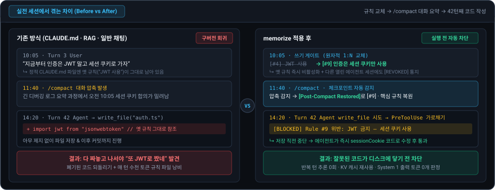

# memorize

[English (README.md)](./README.md) · [아키텍처 레퍼런스](./ARCHITECTURE.ko.md)

**AI 코딩 에이전트용 상태 메모리 플러그인 — 규칙이 바뀌면 옛 지시는 즉시 폐기하고, 언제나 최신 결정만 강제합니다.**

*단일 로컬 바이너리로 **Claude Code · Antigravity** 및 **범용 MCP 클라이언트**와 **웹 콘솔**을 함께 제공합니다.*

### 기존 채팅 메모리는 왜 자꾸 꼬일까요?

- **대화창 컨텍스트**: 대화가 길어져 요약·압축되면 초반에 합의한 규칙부터 밀려나 사라집니다.
- **정적 규칙 파일 (`CLAUDE.md` 등)**: 매 턴 전체를 다시 읽혀 토큰과 컨텍스트 창을 소모하고, 채팅에서 바꾼 새 결정과 충돌해 옛 규칙으로 되돌아갑니다.
- **기존 벡터 RAG**: 유사해 보이는 몇 조각(`TOP-K`)만 뽑아 오다 보니 표현이 다른 필수 제약을 놓치거나 폐기된 옛 규칙을 함께 불러옵니다.

### `memorize`는 컨텍스트 관리를 자동으로 처리합니다

사람이 매번 규칙 파일을 수동 편집하거나 `"이거 기억해"`라고 명령하지 않아도, 라이프사이클 훅이 채팅 흐름을 감싸 최신 컨텍스트를 유지합니다:

1. **자동 정제 · 덮어쓰기**: 채팅 중 규칙 변경이 감지됐는데 저장 없이 코드부터 고치려 하면 **수정 직전에 멈춰 세워** 먼저 옛 규칙을 덮어쓰고 최신 결정만 남깁니다.
2. **최소 컨텍스트 자동 주입**: 매 턴 필요한 규칙 중 아직 세션에 전달되지 않은 것만 선별 주입해, 대화가 길어져도 컨텍스트 창이 무거워지지 않습니다.
3. **실행 · 커밋 전 자동 차단**: 에이전트가 활성 규칙을 어기는 수정·명령·커밋을 시도하면 실행 전에 차단합니다.

| 연동 방식 | 지원 클라이언트 | 동작 범위 |
| :--- | :--- | :--- |
| **에이전트 플러그인** *(MCP + 훅)* | **Claude Code** · **Antigravity** | 턴별 미전달 규칙 자동 주입, 수정 전 규칙 정제 게이트, PreToolUse · Git pre-commit 자동 차단 |
| **범용 MCP 서버** | **Cursor** · **Windsurf** · **Claude Desktop** 등 MCP 클라이언트 | `stdio` 또는 Streamable HTTP(`/mcp`)로 연결해 동일한 웹 콘솔·System 1 평가·MCP 도구 프로토콜 사용 |



---

## 왜 `memorize`인가요?

> [!IMPORTANT]
> **단순 참고용 메모(Recall)만으로는 코딩 에이전트의 옛 규칙 회귀와 규칙 이탈을 막기 어렵습니다.**

대부분의 AI 에이전트 메모리 도구가 과거 대화·작업 이력을 요약해 나중에 **“참고하게 해주는(Recall)”** 데 머무르는 반면, `memorize`는 다음 세 가지를 **외부 벡터·그래프 DB나 Node/Python 런타임 없는 단일 로컬 Go 바이너리**에 하나로 결합했습니다:

- **규칙의 최신 상태 보장**: 요약 누적이 아니라 **`1:N` 원자적 덮어쓰기 + `[REVOKED]` 폐기 통지**로 옛 규칙 회귀 차단
- **행동 강제(Enforcement)**: 단순 권고(`CLAUDE.md` · `MEMORY.md` · 일반 RAG)에 그치지 않고 **`PreToolUse` · `git pre-commit`으로 실행 직전 위반 차단**
- **토큰·캐시·컴팩트 최적화**: **세션 델타 주입**(반복 턴 추론 `0`회 · 고정 Prefix KV 캐시) + **`0`-토큰 `System 1` 평가** + **`/compact`·체크포인트 이후 자동 복구**

### 기존 방식과의 구조 비교

정적 규칙 파일·벡터 RAG·요약 누적형 메모리와 항목별로 비교하면 동작 구조의 차이가 분명히 드러납니다:

| 기준 | 기존 방식 (`CLAUDE.md` · 벡터 RAG · 요약 누적형) | `memorize` |
| :--- | :--- | :--- |
| **상태 일관성** | 옛 규칙과 새 결정이 혼재해 구버전 회귀 | **원자적 `1:N` 덮어쓰기 · 철회 통지**로 최신 결정만 유지 |
| **전수 평가 · 캐시** | 매 턴 전체 재주입 또는 `TOP-K` 누락 | **반복 턴 추론 `0`회** · 미전달 **100% 병렬 평가** · **고정 Prefix KV 캐시** |
| **직관(`System 1`)** | 범용 LLM의 생성형 추론 지연·토큰 비용 | 경량 결정 엔진의 **출력 토큰 `0`개** 단일 패스 판정 |
| **실행 전 차단** | 긴 대화 후반에 규칙을 잊고 수정·커밋 | **실행 전 · 커밋 전 가드레일**로 위반 작업 사전 차단 |
| **컴팩트 후 자동 복구** | `/compact` · 대화 요약 시 초반 규칙 유실 | **압축 요약 · 체크포인트 자동 감지**로 고정 규칙·작업 현황·연관 결정 즉시 복원 |
| **이종 AI 에이전트 호환** | 툴(`CLAUDE.md` 등)마다 규칙이 달라 에이전트를 바꾸면 맥락 단절 | **서로 다른 AI 에이전트·모델을 함께·번갈아 써도** (Claude Code · Antigravity · Cursor 등) **하나의 공유 DB로 동일한 최신 규칙이 그대로 적용** |
| **오케스트레이션 · 멀티 에이전트** | 서브에이전트마다 규칙 재복사 · 병렬 세션 불일치 | **세션별 델타 자동 전달** · **경량 워커도 `PreToolUse` 검증** · **변경·철회 즉시 전파** |
| **상주 데몬 · 저장소 격리** | 매번 콜드스타트 & 로그·진행·규칙 뒤섞임 | **단일 WAL 데몬**(`127.0.0.1:18095`) · **기억·진행(`project_progress`)·실시간 세션·감사 · 3단 스코프 격리** |

*(세부 DB 구조, MCP 도구 명세, 내부 엔드포인트는 [아키텍처 레퍼런스](./ARCHITECTURE.ko.md)에 정리되어 있습니다.)*

---

## 빠른 시작

<table>
<thead><tr><th align="left">개발자의 한마디 (TL;DR)</th></tr></thead>
<tbody><tr><td>
<ol>
<li><strong>설치</strong>하고</li>
<li><strong>대시보드</strong>에서 <strong>빠른 추론 모델</strong>을 고른 다음</li>
<li><strong>에이전트 코딩</strong>을 즐기시면 됩니다.</li>
<li>가끔 <strong>대시보드</strong>를 보며 <strong>바이브</strong>를 느껴보세요.</li>
</ol>
<p><em>(기존 프로젝트라면 채팅에서 <strong>온보딩</strong>을 요청하세요.)</em></p>
</td></tr></tbody>
</table>

### 1. 설치

**Claude Code** *(macOS · Linux 플러그인 런처)*

```bash
/plugin marketplace add https://github.com/marbasdev/memorize.git
/plugin install memorize@memorize-marketplace
```

**Antigravity (`agy`)** *(macOS · Linux 플러그인 런처)*

```bash
git clone https://github.com/marbasdev/memorize.git && cd memorize
agy plugin install ./plugins/memorize
```

**단독 바이너리 · Windows · 기타 MCP 클라이언트** (Cursor · Windsurf · Claude Desktop)

```bash
CGO_ENABLED=0 go build -trimpath -o bin/memorize ./cmd/memorize
```

빌드 후 클라이언트 MCP 설정에 `./plugins/memorize/scripts/run-memorize.sh`(`macOS`/`Linux` 플러그인 `stdio`), `bin/memorize` / `memorize.exe`(단독 `stdio`, Windows는 `memorize.exe -hook <event>` 지원), 또는 `http://127.0.0.1:18095/mcp`를 등록하세요.

### 2. 추론 엔진 연결 (필수)

> [!WARNING]
> **추론 엔진 설정 전에는 핵심 기능이 동작하지 않습니다.**
> 기억 저장, 의미 기반 검색, 실행 전 규칙 차단은 추론 엔진이 연결되어야 실행됩니다.

클라이언트에서 첫 MCP 또는 훅이 실행되면 백그라운드 데몬과 웹 콘솔(**`http://127.0.0.1:18095`**)이 자동 기동됩니다. 웹 콘솔의 **추론 엔진** 탭에서 환경에 맞게 연결하세요:

- **macOS · Linux**: **로컬 GGUF** 권장 모델 1클릭 다운로드 *(또는 `Gemini` · `System 1` · `로컬 URL`)*
- **Windows**: 내장 GGUF 미지원 → **로컬 URL**(`Ollama` · `LM Studio` · `vLLM`), `System 1`, 또는 `Gemini API 키` 연결

> [!TIP]
> **개발자 팁 — 개인용으로는 Gemini 무료 티어도 꽤 편하게 쓸 수 있습니다**: 로컬 모델을 직접 띄우기 부담스럽거나 Windows 환경에서 가볍게 쓰고 싶다면, **Gemini Flash**(`Flash-Lite` 포함)와 **Gemini Decision(`gemini-decision-1`)** 조합을 **무료 티어**로 연결해도 개인 개발 용도에서는 상당히 쾌적하게 동작합니다. *(세션 델타로 반복 턴 재평가가 없고 `429` 한도 도달 시 Flash 계열 자동 폴백을 지원합니다. 무료 할당량과 지원 모델은 Google AI Studio 정책에 따릅니다.)*

### 3. 기존 프로젝트 온보딩 *(기존 코드베이스 첫 연결)*

이미 개발이 진행된 **기존 Git 프로젝트**에서도 처음부터 규칙을 일일이 적어 넣을 필요 없이 온보딩을 지원합니다. 추론 엔진이 연결된 상태에서 기억이 `0`개인 `project:<저장소>`로 첫 대화를 열면(**Claude Code** · **Antigravity** 훅 환경) **초기 규칙 온보딩을 자동으로 제안**합니다:

- **핵심 파일 점검 · 상충 패턴 우선 정리**: 온보딩을 수락하면 에이전트가 저장소 핵심 파일·매니페스트를 직접 살펴보고, **기존 코드에 서로 어긋나는 옛 패턴과 새 패턴이 공존할 때 먼저 어떤 기준을 따를지 물어본 뒤** 확정된 규칙만 저장하고 위반 파일 정비까지 이어갑니다.
- **건너뛰기 · 재실행 & Git 기준점 동기화**: 원치 않으면 건너뛰고(`skip_onboarding`) 나중에 다시 켜서(`reset_onboarding`) 실행할 수 있으며, `MEMORY_GIT_SYNC=1`을 켜면 오래된 과거 이력은 건너뛰고 `HEAD` 기준점 이후 커밋 변경분만 점진 동기화할 수 있습니다. *(훅 없는 일반 MCP 클라이언트는 채팅에서 온보딩이나 `memorize://playbook/memory-curator` 실행을 요청하면 됩니다.)*

---

## 웹 콘솔 (기본 `http://127.0.0.1:18095`)

대표 화면인 **기억 관리** 탭 외 나머지 탭도 클릭해 동작 화면을 확인할 수 있습니다.

<details open>
<summary><strong>기억 관리</strong> — 스코프 KPI · 2D 트리맵 분포 · 인라인 수정/고정 · AI 중복 병합</summary>



</details>

<details>
<summary><strong>진행 현황</strong> — 읽기 전용 3칸 작업 보드 · 기억/Git 동기화 · 자동 TTL</summary>



</details>

<details>
<summary><strong>가드레일</strong> — 작업 계획 사전 검사 · 도구 실행/커밋 감사 로그 · PASS 우선 정리</summary>



</details>

<details>
<summary><strong>추론 엔진</strong> — 상단 접이식 텔레메트리 · 미설정 경고 배너 · 로컬 GGUF 1클릭 다운로드 · 기능별 라우팅</summary>



</details>

<details>
<summary><strong>임계값 · 테스트</strong> — 스코프별 확신도 분포 · 게이트 임계값 튜닝 · 실시간 조회 검증</summary>



</details>

### 기억 관리 · 정리

대화가 쌓이면서 기억이 늘어나더라도 웹 콘솔의 **기억 관리** 탭에서 원문과 이력을 훼손하지 않고 구조를 깔끔하게 유지할 수 있습니다:

- **2D 트리맵 분포 & 안전 재분류**: **카테고리 · 서브카테고리 기억 분포** 카드에서 `미분류` 항목과 서로 다른 카테고리에 겹친 `중복 서브카테고리`를 한눈에 확인합니다. `카테고리 설정...`으로 분류 프리셋·자동완성을 맞추고, **`AI 분류 정리...`**를 실행하면 **기억 본문은 한 글자도 바꾸지 않은 채** 카테고리와 서브카테고리 태그만 안전하게 재배치합니다.
- **AI 중복 통합 · 수동 병합 (`기억 병합...`)**: 여러 세션에 흩어진 유사 기억은 **AI 병합 추천**으로 자동 그룹핑하거나 **수동 선택**으로 직접 묶어 단일 규칙으로 통합할 수 있으며, 통합 후에도 기존 규칙과의 `Replaces` 대체 계보가 유지됩니다.
- **고정 헌법 · 복구 가능한 생명주기**: 핵심 불변 규칙은 인라인 편집에서 **`고정 헌법`**으로 승격해 관련도 평가와 무관하게 항상 주입하고, 불필요해진 기억은 `비활성화 (Forget)` → `되돌리기 (Undo)` → `폐기 정리` 순서로 안전하게 정리합니다. *(폐기 정리 후에도 활성 기억의 `Replaces` 이력은 보존됩니다.)*
- **Git 저장소 기준 프로젝트별 기억 분리 (3단 스코프)**: **Git 저장소(`.git`) 사용을 전제로 저장소 루트를 자동 인식**해 `project:<저장소>` 단위로 규칙과 진행 현황을 분리 저장하므로, 여러 프로젝트를 오가도 규칙이 섞이지 않습니다. 공통·개인 설정은 `global` · `personal` 스코프로 분리 유지되며, 상단의 **`개인 기억 포함`** 체크박스로 프로젝트 조회 시 개인 기억까지 함께 확인할 수 있습니다.

---

## 동작 범위 및 현실적 한계

- **Git 저장소 사용 전제 (프로젝트 식별 · Git 연동)**: 프로젝트 단위 자동 구분(`project:<저장소>`), Git 변경 동기화, `pre-commit` 가드레일은 **Git 저장소(`.git`) 루트 인식**을 기준으로 동작합니다. `.git`이 없는 일반 폴더에서는 현재 작업 디렉토리명(`cwd`) 기준으로만 임시 구분되므로, 하위 폴더 이동 시에도 일관되게 프로젝트를 분리하려면 Git 저장소 안에서 사용하는 것을 권장합니다.
- **이미 출력된 과거 채팅은 지울 수 없음**: 옛 규칙 폐기 알림과 실행 전 차단으로 새 실수는 막지만, 대화창 위쪽에 이미 적힌 과거 답변 문장 자체를 소급 수정하지는 않습니다.
- **훅 없는 MCP 클라이언트의 요약 후 수동 재조회**: **Claude Code**(`PostCompact` · `SessionStart`)와 **Antigravity**(체크포인트 감지)는 컴팩트 이후 자동으로 규칙을 복구하지만, 훅이 없는 **Cursor · Windsurf** 등 일반 MCP 클라이언트에서 대화가 요약되었다면 `query_project_memory(refresh=true)`를 한 번 호출해야 합니다.
- **에이전트별 자동화 범위**: **Claude Code** · **Antigravity**는 훅으로 매 턴 규칙 주입과 실행 전 차단을 자동 강제하고, 그 외 MCP 클라이언트는 에이전트가 필요할 때 메모리 도구를 호출해 사용합니다.

---

## 데몬 제어 · 저장 경로 · 유지보수

### 공통 데이터 디렉토리 (`~/.memorize`)

어떤 클라이언트(**Claude Code**, **Antigravity**, 일반 **MCP 클라이언트**)에서 설치·연동하더라도 실행 바이너리, DB, 로컬 모델, 데몬 상태 파일은 호스트 설정 폴더(`~/.claude`, `~/.gemini`, `~/.cursor`)와 분리된 중립 기본 경로 **`~/.memorize`**(Windows: `%USERPROFILE%\.memorize`)에 통합 저장됩니다. 경로를 바꾸려면 `MEMORY_DATA_DIR`(또는 `MEMORY_DB_PATH`) 환경변수를 설정하세요.

### 백그라운드 데몬 · 포트 변경

데몬/웹 콘솔(기본 `18095`)과 내장 로컬 GGUF 서버(기본 `18088`) 포트는 CLI나 웹 콘솔 상단 배지(`memorize :18095`)에서 바꿀 수 있으며, 지정한 포트가 사용 중이면 빈 루프백 포트로 **자동 폴백**하고 훅·열린 MCP `stdio` 브리지가 새 포트를 자동 추적합니다.

```bash
~/.memorize/bin/memorize daemon status                 # status | start | stop | restart | logs (소스 빌드 시 ./bin/memorize)
~/.memorize/bin/memorize daemon port                   # 현재 설정·활성 포트 확인
~/.memorize/bin/memorize daemon port 19095 19088       # 데몬 · GGUF 포트 변경 (또는 --daemon N --gguf N)
~/.memorize/bin/memorize daemon port reset             # 기본 포트(18095 / 18088) 복원
```

### 업데이트 (`memories.db` 자동 유지 · 마이그레이션)

```bash
# Claude Code
/plugin update

# Antigravity
git pull && agy plugin install ./plugins/memorize

# 소스 직접 빌드 사용 시
git pull && CGO_ENABLED=0 go build -trimpath -o bin/memorize ./cmd/memorize
./plugins/memorize/scripts/run-memorize.sh daemon restart
```

### SQLite 백업 및 복원

```bash
# 안전 백업 (WAL 체크포인트 포함)
sqlite3 ~/.memorize/memories.db ".backup './memories-backup.db'"

# 안전 복원 (데몬 정지 및 기존 WAL/SHM 파일 정리 후 교체)
~/.memorize/bin/memorize daemon stop
mkdir -p ~/.memorize && rm -f ~/.memorize/memories.db-wal ~/.memorize/memories.db-shm
cp ./memories-backup.db ~/.memorize/memories.db
~/.memorize/bin/memorize daemon start
```

### 삭제

```bash
# 1. 클라이언트 플러그인 · MCP · Git 훅 연동만 제거 (memories.db 보존)
/plugin uninstall memorize                    # Claude Code
agy plugin uninstall memorize                 # Antigravity
# 일반 MCP 클라이언트 (Cursor · Windsurf · Claude Desktop): MCP 설정 파일에서 "memorize" 항목 제거
# Git 훅을 설치한 저장소(`memorize -install git-hook`): rm -f .git/hooks/pre-commit

# 2. 데몬 정지 후 공통 바이너리·모델·로컬 데이터 완전 삭제
~/.memorize/bin/memorize daemon stop
rm -rf ~/.memorize                            # MEMORY_DATA_DIR 변경 시 해당 경로 (Windows: Remove-Item -Recurse "$env:USERPROFILE\.memorize")
```

---

## 로드맵 · 의견 남기기 · 문서

- **로드맵 (`v1.0` 이후 예정)**
  - **팀 공용 서버 모드**: 여러 개발자와 팀이 하나의 규칙·가드레일 저장소를 실시간으로 공유하는 공용 데몬 모드
  - **기기 간 동기화 지원**: DB 파일 통째 복사 없이 여러 작업 PC 간 프로젝트 규칙·계보와 진행 상태 동기화
- **의견 및 피드백**: 외부 코드 PR(컨트리뷰션)은 받지 않지만, 사용 중 의견·버그·취약점 제보는 [GitHub Issues](https://github.com/marbasdev/memorize/issues)에 남겨주시면 확인되는 대로 즉시 조치하겠습니다. *(취약점의 세부 익스플로잇 내용은 공개 이슈에 적지 마세요 — [보안 정책](./SECURITY.md))*
- **문서**: [아키텍처 & 환경변수](./ARCHITECTURE.ko.md) · [피드백 및 기여 정책](./CONTRIBUTING.md) · [보안 정책](./SECURITY.md) · [MIT License](./LICENSE)
