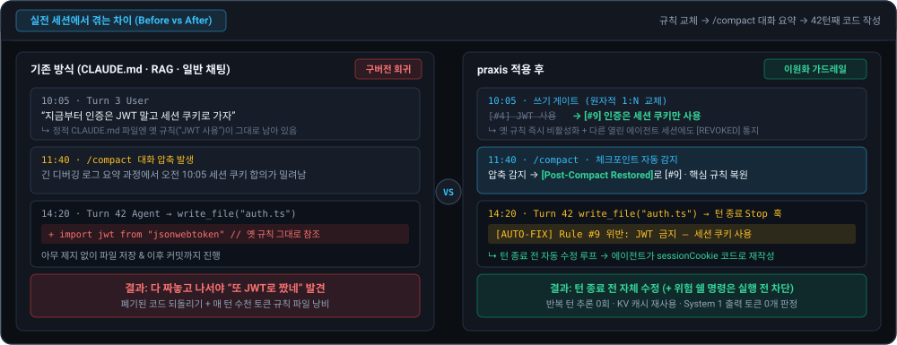

# praxis

[English (README.md)](./README.md) · [팀 협업 & 다기기 가이드](./TEAM.ko.md) · [아키텍처 레퍼런스](./ARCHITECTURE.ko.md) · [AI 자율 설정 가이드](./guides/AI_SETUP.ko.md)

**AI 코딩 에이전트용 상태 메모리 & 실행 하네스 — 기억하는 데서 멈추지 않고, 최신 규칙을 코드와 쉘 실행에 직접 관철합니다.**

_외부 DB나 Python · Node 설치 없는 **단일 로컬 Go 바이너리**로 **Claude Code · Antigravity · 범용 MCP 클라이언트**와 **웹 콘솔**을 함께 제공합니다._

---

## 왜 일반 메모리 MCP · `CLAUDE.md` 대신 `praxis`인가요?

시중의 메모리 MCP들은 과거 대화를 저장해 나중에 **“참고(Recall)”**하게 해 줄 뿐, 에이전트가 도구를 안 부르면 작동하지 않고 참고한 규칙을 어겨도 막지 못합니다. 정적 `CLAUDE.md` 파일 역시 매 턴 토큰만 소모할 뿐 대화 중 바뀐 새 결정과 충돌합니다.

`praxis`는 라이프사이클 훅으로 에이전트 실행 흐름을 감싸 **수동 조작 없이 최신 결정만 유지하고, 규칙 위반을 실행 단계에서 직접 차단·교정**합니다:

| 기준 | `CLAUDE.md` · 일반 메모리 MCP | `praxis` |
| :--- | :--- | :--- |
| **사용성 (수동 개입 `0`)** | `"기억해"` 명령·도구 호출에 의존하거나 규칙 파일을 직접 수정 | **평소처럼 대화만 하면 자동 반영** · 코드 수정 전 새 결정 선반영 강제 |
| **규칙 충돌 · 압축 복구** | 옛 메모와 새 지시가 뒤섞이고 `/compact` 요약 시 초반 합의 유실 | **바뀐 결정이 옛 규칙을 즉시 덮어써 폐기** · `/compact` 후 핵심 규칙 자동 복원 |
| **토큰 · 속도 효율** | 매 턴 전체 파일 재주입(토큰 낭비) 또는 도구 왕복 지연·검색 누락 | **이번 턴에 새로 필요한 규칙만 주입(반복 턴 추론 `0`회)** · 편집 중 흐름 끊김 없음 |
| **실행 강제 · 자체 수정** | 참고만 할 뿐 규칙을 어기고 수정·커밋해도 제지 불가 | **위험 쉘 명령 사전 차단** + **턴 종료 시 위반 코드 자동 수정** + `git pre-commit` 방어 |
| **이종 에이전트 연속성** | 툴마다 규칙 파일·기억이 따로 놀아 에이전트를 바꾸면 맥락 단절 | **Claude Code · Antigravity · Cursor를 번갈아 써도** 하나의 DB로 동일한 최신 규칙 공유 |
| **설치 · 런타임** | Python/Node 런타임, 외부 벡터·그래프 DB 설치 및 콜드스타트 | **외부 의존성 `0`개 단일 실행 파일** · 자동 기동 상주 데몬 + 내장 웹 콘솔 |

| 연동 방식 | 지원 클라이언트 | 동작 범위 |
| :--- | :--- | :--- |
| **에이전트 플러그인** _(MCP + 훅)_ | **Claude Code** · **Antigravity** | 턴별 미전달 규칙 자동 주입 · 수정 전 규칙 정제 · 쉘 사전 차단 · 턴 종료 자체 수정 · `pre-commit` |
| **범용 MCP 서버** | **Cursor** · **Windsurf** · **Claude Desktop** 등 | `stdio` 또는 Streamable HTTP(`/mcp`)로 연결해 동일한 DB · 웹 콘솔 · 평가 엔진 · MCP 도구 사용 |



---

## 빠른 시작

> [!TIP]
> **AI 에이전트 1줄 자동 설정**: 에이전트 채팅창에 아래 문구를 붙여넣으면 설치부터 `praxis doctor` 상태 점검, 초기 프로젝트 온보딩까지 스스로 진행합니다.
> ```text
> guides/AI_SETUP.ko.md 가이드를 따라 이 프로젝트에 praxis를 설치 및 설정해 줘. praxis doctor로 상태를 점검하고, 추론 엔진 상태를 확인한 뒤 초기 프로젝트 온보딩을 진행해 줘.
> ```

### 1. 설치 및 진단

**Claude Code** _(macOS · Linux)_
```bash
/plugin marketplace add https://github.com/marbasdev/praxis.git
/plugin install praxis@praxis-marketplace
```

**Antigravity (`agy`)** _(macOS · Linux)_
```bash
git clone https://github.com/marbasdev/praxis.git && cd praxis
agy plugin install ./plugins/praxis
```

**단독 바이너리 · Windows · 기타 MCP 클라이언트** _(Cursor · Windsurf · Claude Desktop)_
```bash
CGO_ENABLED=0 go build -trimpath -o bin/praxis ./cmd/praxis
```
클라이언트 MCP 설정에 `./plugins/praxis/scripts/run-praxis.sh`(macOS/Linux 자동 동기화 래퍼), `bin/praxis`(`praxis.exe`), 또는 `http://127.0.0.1:18095/mcp`를 등록하세요. 설치 후 아래 명령으로 전체 상태를 즉시 점검할 수 있습니다:
```bash
praxis doctor
```

### 2. 추론 엔진 연결 _(필수)_

> [!WARNING]
> 기억 정제·관련도 선별·실행 전 규칙 차단은 **추론 엔진이 연결되어야 동작**합니다.

첫 MCP·훅 실행 시 자동 기동되는 웹 콘솔(**`http://127.0.0.1:18095`**)의 **추론 엔진** 탭에서 환경에 맞는 엔진을 선택하세요:
- **macOS · Linux**: **로컬 GGUF** 권장 모델 1클릭 다운로드 _(API 키 불필요, 또는 `Gemini` · `System 1` · `로컬 URL`)_
- **Windows**: **로컬 URL**(`Ollama` · `LM Studio` · `vLLM`), `Gemini API 키`, 또는 `System 1` 연결 _(내장 GGUF 미지원)_
- **팀 서버 · 다기기 연결 _(선택)_**: 사내 팀 서버나 개인 메인 서버에 `praxis connect`로 연결하면 로컬 모델 없이 바로 사용 가능합니다 — [팀 협업 가이드](./TEAM.ko.md)

### 3. 기존 프로젝트 온보딩 _(첫 연결 시 1회)_

기존 Git 저장소에서 기억이 `0`개인 상태로 첫 대화를 시작하면 자동으로 초기 규칙 온보딩을 제안합니다:
- 핵심 파일·매니페스트를 분석하며, **코드 내 옛 패턴과 새 패턴이 충돌하면 어떤 기준을 따를지 먼저 확인한 뒤** 확정된 규칙만 저장합니다.
- 원치 않으면 건너뛰고(`skip_onboarding`) 언제든 다시 실행(`reset_onboarding`)할 수 있습니다. _(훅 없는 MCP 클라이언트는 채팅에서 온보딩을 요청하세요.)_

---

## 웹 콘솔 (`http://127.0.0.1:18095`)

<details open>
<summary><strong>기억 관리</strong> — 스코프 KPI · 2D 트리맵 분포 · 인라인 수정/고정 · AI 중복 병합</summary>



</details>

<details>
<summary><strong>진행 현황</strong> — 읽기 전용 프로젝트 활동 보드 · 기억/Git 동기화 · 자동 TTL</summary>


</details>

<details>
<summary><strong>가드레일</strong> — 작업 계획 사전 검사 · 도구 실행/커밋 감사 로그 · PASS 우선 정리</summary>


</details>

<details>
<summary><strong>추론 엔진</strong> — 지연 시간 텔레메트리 · 로컬 GGUF 1클릭 다운로드 · 태스크별 라우팅</summary>


</details>

<details>
<summary><strong>임계값 · 테스트</strong> — 스코프별 확신도 분포 · 게이트 임계값 튜닝 · 실시간 조회 검증</summary>


</details>

- **안전한 분류 · 중복 병합**: **2D 트리맵**에서 미분류·중복 서브카테고리를 확인해 본문 변형 없이 태그만 **`AI 분류 정리`**하거나, 흩어진 유사 기억을 **`AI 병합 추천`**으로 단일 규칙에 통합합니다 _(기존 규칙과의 `Replaces` 대체 계보 유지)_.
- **핵심 고정 & 복구 가능한 정리**: 항상 주입할 불변 규칙은 **`핵심 고정 규칙`**으로 지정하고, 불필요한 기억은 `비활성화(Forget)` → `되돌리기(Undo)` → `폐기 정리` 순으로 안전하게 관리합니다.
- **Git 저장소별 자동 격리**: `.git` 루트 기준으로 `project:<저장소>`를 자동 분리하며, 전 프로젝트 공통 개발 규칙(`global`)·개인 메모(`personal`)·팀 표준(`.praxis/TEAM_RULES.md`)을 섞이지 않게 계층화합니다.

---

## 유지보수 · 백업 · 삭제

모든 런타임 데이터(바이너리, `memories.db`, 로컬 모델)는 클라이언트와 무관하게 **`~/.praxis`**(Windows: `%USERPROFILE%\.praxis`, `PRAXIS_DATA_DIR`로 변경 가능) 한곳에 저장됩니다.

```bash
# 데몬 상태 점검 및 제어 (포트 충돌 시 빈 포트로 자동 폴백)
~/.praxis/bin/praxis doctor
~/.praxis/bin/praxis daemon status    # start | stop | restart | logs | port
```

### 업데이트 (`memories.db` 자동 보존)
```bash
/plugin update                                                        # Claude Code
git pull && agy plugin install ./plugins/praxis                       # Antigravity
git pull && CGO_ENABLED=0 go build -trimpath -o bin/praxis ./cmd/praxis && ./plugins/praxis/scripts/run-praxis.sh daemon restart
```

### 백업 · 복원
```bash
# 안전 백업 (SQLite 온라인 백업 또는 포터블 JSON 번들 내보내기)
sqlite3 ~/.praxis/memories.db ".backup './memories-backup.db'"
~/.praxis/bin/praxis export --scope global -o global.json

# DB 전체 복원
~/.praxis/bin/praxis daemon stop
rm -f ~/.praxis/memories.db-wal ~/.praxis/memories.db-shm
cp ./memories-backup.db ~/.praxis/memories.db
~/.praxis/bin/praxis daemon start
```

### 삭제
```bash
# 1. 클라이언트 연동만 해제 (데이터 보존)
/plugin uninstall praxis      # Claude Code
agy plugin uninstall praxis   # Antigravity
# 기타 MCP 클라이언트는 설정 파일에서 "praxis" 제거 (Git 훅 설치 시 rm -f .git/hooks/pre-commit)

# 2. 데몬 정지 및 로컬 데이터 완전 삭제
~/.praxis/bin/praxis daemon stop && rm -rf ~/.praxis
```

> **참고**: 프로젝트 자동 식별과 `pre-commit` 가드레일은 **Git 저장소(`.git`)** 기준이며, 훅이 없는 일반 MCP 클라이언트에서 대화가 요약된 뒤에는 `query_project_memory(refresh=true)`를 1회 호출하면 규칙이 다시 복구됩니다.

---

## 문서 · 피드백

- **문서**: [팀 협업 & 다기기 가이드](./TEAM.ko.md) · [아키텍처 & 환경변수 레퍼런스](./ARCHITECTURE.ko.md) · [AI 자율 설정 가이드](./guides/AI_SETUP.ko.md) · [기여 정책](./CONTRIBUTING.md) · [보안 정책](./SECURITY.md) · [MIT License](./LICENSE)
- **피드백**: 외부 코드 PR은 받지 않지만, 사용 중 의견·버그·취약점 제보는 [GitHub Issues](https://github.com/marbasdev/praxis/issues)에 남겨주시면 즉시 확인해 반영합니다.
