# praxis

[English (README.md)](./README.md) · [팀 협업 & 다기기 가이드](./TEAM.ko.md) · [아키텍처 레퍼런스](./ARCHITECTURE.ko.md) · [AI 자율 설정 가이드](./guides/AI_SETUP.ko.md)

**기억하는 데서 멈추지 않고, 최신 규칙을 코드와 쉘 실행에 직접 관철하는 AI 코딩 하네스.**

_외부 DB나 Python · Node 런타임 없이 **단일 로컬 Go 실행 파일** 하나로 **Claude Code · Antigravity · 범용 MCP 클라이언트**와 **웹 콘솔**을 제공합니다._

---

## `praxis`는 무엇이 다른가요?

일반 메모리 MCP는 에이전트가 직접 검색·저장 도구를 호출해야만 과거 메모를 **“참고(Recall)”**할 수 있고, 정적 `CLAUDE.md` 파일은 매 턴 토큰만 소모할 뿐 에이전트가 규칙을 어기고 코드를 짜도 막을 방법이 없습니다.

`praxis`는 에이전트 실행 앞뒤를 라이프사이클 훅으로 감싸 **사람이 규칙 파일을 관리하거나 `"기억해"`라고 시키지 않아도** 다음 세 가지를 자동으로 수행합니다:

1. **바뀌면 즉시 덮어쓰기**: 대화 중 규칙 변경이 감지되면 코드 수정 전에 옛 규칙을 먼저 교체·폐기하고, `/compact` 대화 압축 이후에도 핵심 규칙을 자동 복원합니다.
2. **새로 필요한 규칙만 최소 주입**: 매 턴 전체 규칙을 다시 읽히지 않고 이번 세션에 아직 전달되지 않은 규칙만 골라 주입해 반복 턴 토큰 낭비와 지연이 없습니다.
3. **실행 차단 · 턴 종료 자체 수정**: 되돌릴 수 없는 쉘 명령은 실행 직전에 즉시 차단하고, 파일 편집은 흐름을 끊지 않은 뒤 **턴이 끝날 때 변경 diff 전체를 점검해 위반 코드를 에이전트 스스로 고치게 합니다** _(`git pre-commit` 최종 방어 포함)_.


| 비교 항목 | `CLAUDE.md` · 일반 메모리 MCP | `praxis` |
| :--- | :--- | :--- |
| **사용성** | 수동 파일 편집이나 에이전트의 도구 호출 여부에 의존 | **평소처럼 대화만 하면 자동 반영** · 코드 수정 전 새 결정 선반영 강제 |
| **규칙 일관성** | 과거 메모와 새 지시가 뒤섞이고 `/compact` 후 초반 합의 유실 | **새 결정이 옛 규칙을 즉시 덮어써 폐기** · 압축 후 핵심 규칙 자동 복원 |
| **토큰 · 속도 효율** | 매 턴 전체 파일 재주입 또는 도구 왕복 지연 · 검색 누락 | **미전달 변경분만 주입(반복 턴 추론 `0`회)** · 파일 편집 중 대기 없음 |
| **실행 강제력** | 단순 참고용 — 규칙을 어기고 수정·커밋해도 제지 불가 | **위험 쉘 사전 차단** + **턴 종료 시 위반 코드 자체 수정** + `pre-commit` 검사 |
| **에이전트 연속성** | 툴마다 규칙 파일·메모리가 달라 에이전트 전환 시 맥락 단절 | **Claude Code · Antigravity · Cursor를 번갈아 써도** 동일 DB로 최신 규칙 유지 |
| **설치 · 인프라** | Python/Node 런타임, 외부 벡터·그래프 DB 설치 필요 | **외부 의존성 `0`개 단일 바이너리** · 첫 호출 시 상주 데몬 & 웹 콘솔 자동 기동 |

### 프로젝트 간 혼선을 막는 4계층 자동 격리
`.git` 루트를 자동 인식해 저장소마다 `project:<저장소>` 규칙을 분리하므로 여러 프로젝트를 오가도 규칙이 섞이지 않습니다. 조회·검증 시에는 **`팀 룰팩(.praxis/TEAM_RULES.md)` → `project:<저장소>` → `공통 개발 규칙(global)` → `개인 메모(personal, 선택 포함)`** 순으로 일관되게 적용됩니다.

---

## 빠른 시작

> [!TIP]
> **AI 에이전트 1줄 자동 설정**: 사용 중인 에이전트 채팅창에 아래 문장을 붙여넣으면 설치부터 `praxis doctor` 점검, 초기 온보딩까지 알아서 진행합니다.
> ```text
> guides/AI_SETUP.ko.md 가이드를 따라 이 프로젝트에 praxis를 설치 및 설정해 줘. praxis doctor로 상태를 점검하고, 추론 엔진 상태를 확인한 뒤 초기 프로젝트 온보딩을 진행해 줘.
> ```

### 1. 클라이언트 설치

- **에이전트 플러그인 (Claude Code · Antigravity — _자동 훅 + 가드레일 + MCP 전체 동작_)**
  ```bash
  # Claude Code (macOS · Linux)
  /plugin marketplace add https://github.com/marbasdev/praxis.git
  /plugin install praxis@praxis-marketplace

  # Antigravity (macOS · Linux)
  git clone https://github.com/marbasdev/praxis.git && cd praxis
  agy plugin install ./plugins/praxis
  ```

- **범용 MCP 클라이언트 · Windows (Cursor · Windsurf · Claude Desktop — _공유 DB + 웹 콘솔 + MCP 도구_)**
  ```bash
  CGO_ENABLED=0 go build -trimpath -o bin/praxis ./cmd/praxis
  ```
  클라이언트 MCP 설정에 `./plugins/praxis/scripts/run-praxis.sh`(macOS/Linux 자동 갱신 래퍼), `bin/praxis`(`praxis.exe`), 또는 `http://127.0.0.1:18095/mcp`를 등록합니다. 설치 상태는 언제든 아래 명령으로 점검할 수 있습니다:
  ```bash
  praxis doctor
  ```

### 2. 추론 엔진 연결 _(필수)_

> [!WARNING]
> 규칙 정제·관련도 판정·가드레일 차단은 **추론 엔진이 연결되어야 활성화**됩니다.

첫 호출 시 자동 실행되는 웹 콘솔(**`http://127.0.0.1:18095`**)의 **추론 엔진** 탭에서 설정하세요:
- **macOS · Linux**: **로컬 GGUF** 권장 모델 1클릭 다운로드 _(API 키 불필요 · 오프라인 동작, 또는 `Gemini` · `System 1` · `로컬 URL`)_
- **Windows**: **로컬 URL**(`Ollama` · `LM Studio` · `vLLM`), `Gemini API 키`, 또는 `System 1` 연결 _(내장 GGUF 미지원)_
- **팀 서버 · 다기기 공유 _(선택)_**: `praxis connect`로 서버에 연결하면 로컬 모델 설치 없이 바로 사용합니다 — [팀 협업 가이드](./TEAM.ko.md)

### 3. 기존 코드베이스 온보딩 _(첫 대화 시 자동 제안)_

기억이 `0`개인 기존 Git 저장소에서 첫 대화를 열면 초기 규칙 온보딩을 제안합니다. 주요 매니페스트와 코드를 읽되 **코드 안에 옛 패턴과 새 패턴이 섞여 있으면 어느 쪽이 기준인지 먼저 질문한 뒤** 확정된 규칙만 저장합니다. _(건너뛰기 `skip_onboarding` · 재실행 `reset_onboarding` 지원)_

---

## 웹 콘솔 (`http://127.0.0.1:18095`)

<details open>
<summary><strong>기억 관리</strong> — 시맨틱 KPI · 2D 트리맵 분포 · 핵심 고정 · AI 중복 규칙 병합</summary>


- **본문 훼손 없는 분류 & 계보 유지 병합**: 2D 트리맵에서 미분류·중복 서브카테고리를 확인해 태그만 **`AI 분류 정리`**하거나, 여러 세션에 흩어진 유사 규칙을 **`기억 병합`**으로 합치면서 기존 규칙과의 대체 계보(`Replaces`)를 그대로 보존합니다.
- **핵심 고정 & 복구 가능한 수명주기**: 반드시 지켜야 할 불변식은 **`핵심 고정 규칙`**으로 승격해 상시 주입하고, 내린 규칙도 `비활성화(Forget)` → `되돌리기(Undo)` → `폐기 정리` 단계로 안전하게 관리합니다.

</details>

<details>
<summary><strong>팀 룰팩</strong> — <code>.praxis/TEAM_RULES.md</code> 격리 worktree 커밋 · 카테고리 자동완성 · 원격 동기화</summary>



</details>

<details>
<summary><strong>진행 현황</strong> — 작업 · 기억 · Git 통합 읽기 전용 타임라인 · 자동 보관 TTL</summary>



</details>

<details>
<summary><strong>가드레일</strong> — 실행 전 명령·계획 검사 · PreToolUse/Stop/pre-commit 감사 로그</summary>



</details>

<details>
<summary><strong>추론 엔진</strong> — 호출 지연 텔레메트리 · 로컬 GGUF 1클릭 설치 · 태스크별 모델 라우팅</summary>



</details>

<details>
<summary><strong>임계값 · 테스트</strong> — 스코프별 확신도 히스토그램 · 게이트 슬라이더 · 실시간 조회 테스트벤치</summary>



</details>

---

## 운영 · 백업 · 삭제

모든 실행 파일·DB·모델은 클라이언트 설정 폴더와 분리된 **`~/.praxis`**(Windows: `%USERPROFILE%\.praxis`, `PRAXIS_DATA_DIR` 변경 가능)에 통합 저장됩니다.

```bash
~/.praxis/bin/praxis doctor           # 전체 설치·데몬·DB·엔진 상태 진단
~/.praxis/bin/praxis daemon status    # start | stop | restart | logs | port
```

### 업데이트 (`memories.db` 자동 유지)
```bash
/plugin update                                                        # Claude Code
git pull && agy plugin install ./plugins/praxis                       # Antigravity
git pull && CGO_ENABLED=0 go build -trimpath -o bin/praxis ./cmd/praxis && ./plugins/praxis/scripts/run-praxis.sh daemon restart
```

### 백업 · 복원
```bash
# 온라인 안전 백업 (SQLite 스냅샷 또는 스코프별 포터블 JSON 번들)
sqlite3 ~/.praxis/memories.db ".backup './memories-backup.db'"
~/.praxis/bin/praxis export --scope global -o global.json

# 전체 DB 복원
~/.praxis/bin/praxis daemon stop
rm -f ~/.praxis/memories.db-wal ~/.praxis/memories.db-shm
cp ./memories-backup.db ~/.praxis/memories.db && ~/.praxis/bin/praxis daemon start
```

### 삭제
```bash
# 1. 클라이언트 연동만 해제 (기억 데이터 보존)
/plugin uninstall praxis      # Claude Code
agy plugin uninstall praxis   # Antigravity
# 기타 MCP 클라이언트는 설정에서 "praxis" 제거 (Git 훅 설치 저장소는 rm -f .git/hooks/pre-commit)

# 2. 데몬 종료 및 로컬 데이터 완전 삭제
~/.praxis/bin/praxis daemon stop && rm -rf ~/.praxis
```

> **참고**: 프로젝트 단위 자동 분리와 `pre-commit` 검사는 **Git 저장소(`.git`)** 기준이며, 훅이 없는 일반 MCP 클라이언트에서 대화가 요약되었다면 `query_project_memory(refresh=true)`를 1회 호출해 규칙을 복구하세요.

---

## 문서 · 피드백

- **가이드**: [팀 협업 & 다기기 가이드](./TEAM.ko.md) · [아키텍처 & 환경변수 레퍼런스](./ARCHITECTURE.ko.md) · [AI 자율 설정 가이드](./guides/AI_SETUP.ko.md) · [기여 정책](./CONTRIBUTING.md) · [보안 정책](./SECURITY.md) · [MIT License](./LICENSE)
- **피드백**: 외부 코드 PR은 받지 않으며, 버그·개선 의견·취약점 제보는 [GitHub Issues](https://github.com/marbasdev/praxis/issues)에 남겨주시면 확인 즉시 반영합니다.
