# praxis

[한국어 (README.ko.md)](./README.ko.md) · [Team & Multi-Device Guide](./TEAM.md) · [Architecture Reference](./ARCHITECTURE.md) · [AI-First Setup Guide](./guides/AI_SETUP.md)

**Stateful Memory & Execution Harness for AI Coding Agents — doesn't just recall rules; enforces your latest decisions across code and shell execution.**

_Ships as a **single zero-dependency Go binary** powering **Claude Code · Antigravity · generic MCP clients** and a built-in **Web Console** with no Python, Node, or external vector DB._

---

## Why `praxis` over Static Files & Memory MCPs?

Most memory MCPs only help an agent **recall** past notes—if the agent forgets to call the tool, nothing happens, and even recalled rules are never enforced when writing code. Static `CLAUDE.md` files burn tokens every turn while clashing with newer decisions made in chat.

`praxis` wraps the agent lifecycle with hooks to **automatically maintain only the latest truth and block or self-correct violations at execution time**:

| Dimension | `CLAUDE.md` · Generic Memory MCPs | `praxis` |
| :--- | :--- | :--- |
| **Usability (Zero Manual Chore)** | Relies on `"remember this"`, manual file edits, or explicit tool calls | **Just chat naturally** — captures updates automatically and gates edits until new decisions are saved |
| **Conflict & Compaction Safety** | Stale notes pile up beside new ones; `/compact` drops early rules | **New decisions atomically overwrite & retire old rules**; auto-restores after `/compact` |
| **Token & Speed Efficiency** | Re-reads whole files every turn or suffers tool round-trips & `TOP-K` misses | **Injects only unsent deltas (`0` inference on repeat turns)** with zero per-edit stalls |
| **Execution Enforcement** | Advisory only — cannot stop a bad shell command or rule-breaking edit | **Blocks unsafe shell commands upfront** + **auto-fixes violating diffs at turn end** + `git pre-commit` |
| **Cross-Agent Continuity** | Rules fragment across tools (`CLAUDE.md`, `.cursorrules`, separate MCPs) | **Switch freely between Claude Code, Antigravity & Cursor** sharing one live rule DB |
| **Setup & Footprint** | Python/Node runtimes, external vector/graph DBs, cold-start overhead | **Single static binary (`0` external dependencies)** · auto-spawning daemon + Web Console |

| Integration Mode | Supported Clients | Capabilities |
| :--- | :--- | :--- |
| **Agent Plugin** _(MCP + Hooks)_ | **Claude Code** · **Antigravity** | Per-turn delta injection · pre-mutate rule gate · upfront shell block · turn-end auto-fix · `pre-commit` |
| **Universal MCP Server** | **Cursor** · **Windsurf** · **Claude Desktop** & others | Connects over `stdio` or Streamable HTTP (`/mcp`) sharing the same DB, Web Console, evaluator & MCP tools |


---

## Quick Start

> [!TIP]
> **1-Prompt AI Setup**: Paste this prompt into your coding agent to let it install `praxis`, verify health via `praxis doctor`, and guide initial project onboarding automatically:
> ```text
> Please set up and configure praxis for this project following guides/AI_SETUP.md. Run praxis doctor to verify health, confirm the inference engine, and guide me through initial onboarding.
> ```

### 1. Install & Verify

**Claude Code** _(macOS · Linux)_
```bash
/plugin marketplace add https://github.com/marbasdev/praxis.git
/plugin install praxis@praxis-marketplace
```

**Antigravity (`agy`)** _(macOS · Linux)_
```bash
git clone https://github.com/marbasdev/praxis.git && cd praxis
agy plugin install ./plugins/praxis
```

**Standalone Binary · Windows · Generic MCP Clients** _(Cursor · Windsurf · Claude Desktop)_
```bash
CGO_ENABLED=0 go build -trimpath -o bin/praxis ./cmd/praxis
```
Register `./plugins/praxis/scripts/run-praxis.sh` (auto-sync wrapper on macOS/Linux), `bin/praxis` (`praxis.exe`), or `http://127.0.0.1:18095/mcp` in your client's MCP config. Run the built-in diagnostic anytime:
```bash
praxis doctor
```

### 2. Connect an Inference Engine _(Required)_

> [!WARNING]
> Rule extraction, relevance filtering, and guardrail enforcement **require an active inference engine**.

On your first MCP or hook call, the background daemon and Web Console (**`http://127.0.0.1:18095`**) start automatically. Open the **Engines** tab to pick an engine:
- **macOS · Linux**: **1-click Local GGUF download** _(no API key needed; or choose `Gemini` · `System 1` · `Custom Local URL`)_
- **Windows**: Connect a **Custom Local URL** (`Ollama` · `LM Studio` · `vLLM`), `Gemini API key`, or `System 1` _(built-in GGUF unsupported)_
- **Team Server / Multi-Device _(Optional)_**: Connect via `praxis connect` to use a shared server with zero local model setup — see [Team Guide](./TEAM.md)

### 3. Onboard Existing Projects _(First Run)_

When opening an existing Git repository with `0` stored rules, `praxis` automatically offers one-time onboarding:
- Inspects core manifests and source files, **asks which pattern wins whenever legacy and newer conventions conflict**, and commits only confirmed rules.
- You can skip (`skip_onboarding`) or re-trigger (`reset_onboarding`) anytime. _(In hookless MCP clients, simply ask the agent to onboard the project in chat.)_

---

## Web Console (`http://127.0.0.1:18095`)

<details open>
<summary><strong>Memories</strong> — Scope KPIs · 2D Treemap Breakdown · Inline Edit/Pin · AI Consolidation</summary>


</details>

<details>
<summary><strong>Progress</strong> — Read-Only Project Activity Board · Memory & Git Sync · Auto-TTL</summary>


</details>

<details>
<summary><strong>Guardrails</strong> — Pre-Execution Plan Verifier · Tool & Commit Audit Log · PASS-First Cleanup</summary>


</details>

<details>
<summary><strong>Engines</strong> — Latency Telemetry · 1-Click Local GGUF Download · Per-Task Routing</summary>



</details>

<details>
<summary><strong>Calibration & Test</strong> — Per-Scope Confidence Distribution · Threshold Tuning · Live Query Testbench</summary>


</details>

- **Safe Taxonomy & Consolidation**: Spot uncategorized or overlapping subcategories on the **2D Treemap** to re-tag via **`AI Cleanup`** without altering rule text, or merge scattered rules via **`Consolidate`** while preserving `Replaces` lineage.
- **Core Rules & Reversible Lifecycle**: Pin non-negotiable invariants as **`Core Rules`** for guaranteed injection, and retire outdated entries safely via `Forget` → `Undo` → `Purge`.
- **Automatic Per-Repo Isolation**: Detects `.git` roots to isolate `project:<repo>` rules from cross-project `global` conventions, `personal` notes, and Git-tracked `.praxis/TEAM_RULES.md`.

---

## Maintenance, Backup & Uninstall

All runtime files (binary, `memories.db`, local models) live under a single client-neutral directory: **`~/.praxis`** (`%USERPROFILE%\.praxis` on Windows, configurable via `PRAXIS_DATA_DIR`).

```bash
# Health check & daemon lifecycle (auto-falls back to a free port on conflict)
~/.praxis/bin/praxis doctor
~/.praxis/bin/praxis daemon status    # start | stop | restart | logs | port
```

### Update (`memories.db` Preserved Automatically)
```bash
/plugin update                                                        # Claude Code
git pull && agy plugin install ./plugins/praxis                       # Antigravity
git pull && CGO_ENABLED=0 go build -trimpath -o bin/praxis ./cmd/praxis && ./plugins/praxis/scripts/run-praxis.sh daemon restart
```

### Backup & Restore
```bash
# Safe online backup (SQLite snapshot or portable JSON bundle)
sqlite3 ~/.praxis/memories.db ".backup './memories-backup.db'"
~/.praxis/bin/praxis export --scope global -o global.json

# Full DB restore
~/.praxis/bin/praxis daemon stop
rm -f ~/.praxis/memories.db-wal ~/.praxis/memories.db-shm
cp ./memories-backup.db ~/.praxis/memories.db
~/.praxis/bin/praxis daemon start
```

### Uninstall
```bash
# 1. Detach client integration only (keeps memories.db)
/plugin uninstall praxis      # Claude Code
agy plugin uninstall praxis   # Antigravity
# Generic MCP clients: remove "praxis" from MCP config (and rm -f .git/hooks/pre-commit if installed)

# 2. Stop daemon and remove all local data
~/.praxis/bin/praxis daemon stop && rm -rf ~/.praxis
```

> **Note**: Project auto-scoping and `pre-commit` checks rely on a **Git repository (`.git`)** root. In hookless MCP clients (such as Cursor or Windsurf), run `query_project_memory(refresh=true)` once after chat compaction to restore active rules.

---

## Docs & Feedback

- **Docs**: [Team & Multi-Device Guide](./TEAM.md) · [Architecture & Env Reference](./ARCHITECTURE.md) · [AI-First Setup Guide](./guides/AI_SETUP.md) · [Contributing](./CONTRIBUTING.md) · [Security Policy](./SECURITY.md) · [MIT License](./LICENSE)
- **Feedback**: External code PRs are not accepted, but bug reports, feedback, and vulnerability disclosures are always welcome via [GitHub Issues](https://github.com/marbasdev/praxis/issues).
