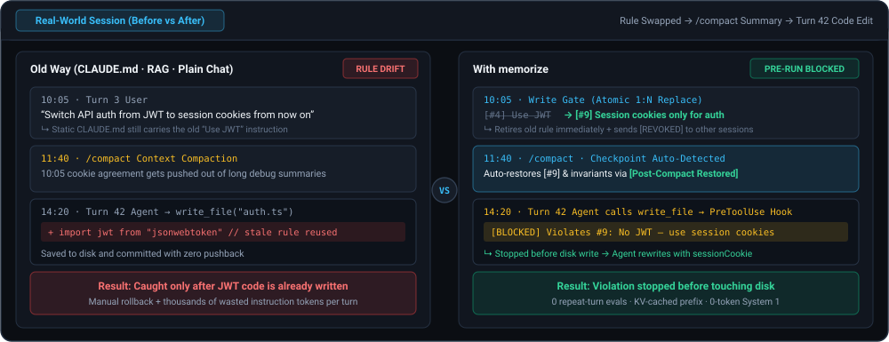

# memorize

[한국어 (README.ko.md)](./README.ko.md) · [Architecture Reference](./ARCHITECTURE.md)

**Stateful memory plugin for AI coding agents — retire stale instructions immediately and enforce only your latest rules.**

*Ships as a **single binary** with a **Web Console** for **Claude Code**, **Antigravity**, and any standard **MCP client**.*

### Why Traditional Chat Memory Breaks Down

- **Conversation Context Window**: Once long chats trigger summarization or compaction, early architectural decisions are the first to vanish.
- **Static Instruction Files (`CLAUDE.md`, etc.)**: Re-injected in full on every turn, wasting context budget while clashing with newer decisions made in chat.
- **Standard Vector RAG**: Pulls only `TOP-K` chunks by similarity—missing constraints phrased differently while dragging deprecated rules back into context.

### Automated Context Management

You do not have to maintain rule files by hand or type "remember this" on every change—lifecycle hooks wrap your coding workflow automatically:

1. **Refine & Overwrite**: When a new or changed rule is detected in chat and the agent tries to edit code before updating memory, a pre-edit hook **pauses execution until stale rules are retired and the latest decision is stored**.
2. **Minimal Delta Injection**: Each turn receives only relevant rules not yet delivered to the active session, keeping your context window lean no matter how long the session runs.
3. **Pre-Execution Blocking**: Tool edits, shell commands, and Git commits are verified against active rules and stopped before violations land.

| Integration Mode | Supported Clients | How It Works |
| :--- | :--- | :--- |
| **Agent Plugin** *(MCP + Hooks)* | **Claude Code** · **Antigravity** | Automatic zero-touch turn delta injection, pre-edit rule refresh gate, and PreToolUse / Git pre-commit guardrails |
| **Standalone MCP Server** | **Cursor** · **Windsurf** · **Claude Desktop** · any MCP client | Connects via `stdio` or Streamable HTTP (`/mcp`) using the same Web Console, System 1 evaluation, and MCP tool protocol |



---

## Why `memorize`?

> [!IMPORTANT]
> **Passive recall alone cannot stop coding agents from regressing to stale rules or drifting out of compliance.**

While most AI agent memory tools stop at summarizing past conversations and logs for later **recall**, `memorize` combines three capabilities in a **single local Go binary** with **no external vector store, graph DB, or Node/Python runtime**:

- **Up-to-Date Rule State**: **`1:N` atomic overwrites and `[REVOKED]` notices** prevent obsolete instructions from lingering or regressing, rather than piling up append-only summaries
- **Execution-Time Enforcement**: Moves beyond passive guidance (`CLAUDE.md`, `MEMORY.md`, plain RAG) with **`PreToolUse` and `git pre-commit` guardrails** that stop violations before execution
- **Token, Cache & Compaction Efficiency**: **Session-delta injection** (`0`-eval repeat turns and static-prefix KV caching), **`0`-output-token `System 1` scoring**, and **automatic recovery after `/compact` or checkpoints**

### Architecture & Workflow Comparison

Comparing item by item against static instruction files, vector RAG, and append-only summary memories shows where the structural difference lies:

| Dimension | Old Way (`CLAUDE.md` · Vector RAG · Log Summary) | `memorize` |
| :--- | :--- | :--- |
| **State Integrity** | Old and new rules mix and cause regressions | **Atomic `1:N` overwrite & revocation** keep only the latest rule |
| **Full Eval & Cache** | Full re-injection every turn or `TOP-K` misses | **0-call repeat turns** · **100% parallel eval** · **static prefix KV cache** |
| **System 1 Speed** | Slow chain-of-thought latency & token overhead | Lightweight engine scores in one pass with **`0` output tokens** |
| **Pre-Run Enforcement** | Agents drift under long-context pressure | **Pre-tool & pre-commit guardrails** block violations before execution |
| **Compaction Recovery** | Long-chat summarization drops early rules | **Auto-detects compaction & checkpoints** to restore invariants, progress & relevant rules |
| **Cross-Agent Portability** | Tool-specific rule files fragment across clients and break on switch | **Mix or switch across AI agents & models** (Claude Code · Antigravity · Cursor · MCP) while **keeping one shared set of live rules & decisions** |
| **Orchestration & Multi-Agent** | Re-pasting rules per worker & parallel drift | **Per-worker delta injection** · **`PreToolUse` checks on smaller workers** · **live rule sync** |
| **Daemon & Isolation** | Per-call cold starts & tangled notes/tasks | **Single WAL daemon** (`127.0.0.1:18095`) · **memories, `project_progress`, live sessions, audit & 3 scopes** |

*(Internal table schemas, MCP tool specs, and decision endpoints are documented in [Architecture Reference](./ARCHITECTURE.md).)*

---

## Quick Start

<table>
<thead><tr><th align="left">Author's Note (TL;DR)</th></tr></thead>
<tbody><tr><td>
<ol>
<li><strong>Install</strong> it</li>
<li>Pick a <strong>fast inference model</strong> in the <strong>dashboard</strong></li>
<li><strong>Enjoy agentic coding</strong></li>
<li>Glance at the <strong>dashboard</strong> now and then and <strong>enjoy the vibe</strong></li>
</ol>
<p><em>(Working in an existing repo? Ask for <strong>onboarding</strong> in your first chat.)</em></p>
</td></tr></tbody>
</table>

### 1. Install

**Claude Code** *(macOS · Linux plugin launcher)*

```bash
/plugin marketplace add https://github.com/marbasdev/memorize.git
/plugin install memorize@memorize-marketplace
```

**Antigravity (`agy`)** *(macOS · Linux plugin launcher)*

```bash
git clone https://github.com/marbasdev/memorize.git && cd memorize
agy plugin install ./plugins/memorize
```

**Standalone CLI / Windows / Other MCP Clients** (Cursor · Windsurf · Claude Desktop)

```bash
CGO_ENABLED=0 go build -trimpath -o bin/memorize ./cmd/memorize
```

Register `./plugins/memorize/scripts/run-memorize.sh` (`macOS`/`Linux` plugin `stdio`), `bin/memorize` / `memorize.exe` (standalone `stdio`, plus `memorize.exe -hook <event>` on Windows), or `http://127.0.0.1:18095/mcp` in your client config.

### 2. Connect an Inference Engine (Required)

> [!WARNING]
> **Core features remain inactive until an inference engine is configured.**
> Committing memories, semantic retrieval, and pre-execution rule blocking all require an active engine.

The local daemon and Web Console (**`http://127.0.0.1:18095`**) start automatically on your first MCP or hook call. Open the **Engines** tab to complete setup:

- **macOS · Linux**: Download a recommended **Local GGUF** model in 1 click *(or connect `Gemini`, `System 1`, or `Custom Local URL`)*
- **Windows**: Built-in GGUF is disabled → connect a **Custom Local URL** (`Ollama` · `LM Studio` · `vLLM`), `System 1`, or a `Gemini API key`

> [!TIP]
> **Developer Tip — Gemini's free tier works comfortably for personal use**: If you prefer not to run a local model or are on Windows, pairing **Gemini Flash** (including `Flash-Lite`) with **Gemini Decision (`gemini-decision-1`)** works quite smoothly on the **free tier** for everyday personal development. *(Session deltas skip repeat-turn calls and built-in `429` Flash fallback handles rate limits; free-tier quotas and model availability follow Google AI Studio policy.)*

### 3. Onboarding an Existing Project *(First Run on a Repo)*

You do not need to write every rule by hand when dropping `memorize` into an **existing Git codebase**. Once an inference engine is ready and you start your first chat in a cold `project:<repo>` with `0` stored memories (**Claude Code** · **Antigravity** hooks), `memorize` **automatically offers initial rule onboarding**:

- **Inspect Key Files & Resolve Conflicts First**: If you accept, the agent inspects core repository files and manifests; **when conflicting legacy and newer patterns coexist, it asks you which pattern takes priority before saving rules**, commits the confirmed decisions, and offers to clean up violating files.
- **Skip / Re-Run & Optional Git Baseline Sync**: Decline anytime (`skip_onboarding`) or restart onboarding later (`reset_onboarding`). Setting `MEMORY_GIT_SYNC=1` also lets you anchor a `HEAD` baseline without replaying ancient commit noise and sync incremental rule changes going forward. *(In hookless MCP clients, simply ask the agent in chat to onboard via `memorize://playbook/memory-curator`.)*

---

## Web Console (Default `http://127.0.0.1:18095`)

Preview the main **Memories** tab below and click any other tab to expand its UI simulation:

<details open>
<summary><strong>Memories</strong> — Scope KPIs · 2D squarified treemap · inline edit/pin · AI duplicate merge</summary>



</details>

<details>
<summary><strong>Progress</strong> — Read-only 3-lane work board · memory &amp; Git sync · Auto-TTL</summary>



</details>

<details>
<summary><strong>Guardrails</strong> — Interactive plan check · tool &amp; commit audit logs · PASS-first cleanup</summary>



</details>

<details>
<summary><strong>Engines</strong> — collapsible telemetry bar · setup alert banner · 1-click Local GGUF · per-feature routing</summary>



</details>

<details>
<summary><strong>Calibration &amp; Test</strong> — Per-scope confidence distribution · gate thresholds · live retrieval probe</summary>



</details>

### Memory Organization & Lifecycle

As sessions accumulate rules over time, the **Memories** tab provides safe curation controls without risking accidental data loss:

- **2D Treemap Distribution & Non-Destructive Re-Categorization**: The **Category & Sub-Category Distribution** map surfaces `unclassified` entries and `Cross-category sub` overlaps at a glance. Manage preset taxonomies and autocomplete labels via **`Categories...`**, then run **`AI Categorize...`** to clean up category and sub-category tags **without rewriting or altering any memory wording**.
- **AI Duplicate Merge & Manual Consolidation (`Consolidate...`)**: Merge overlapping memories across sessions using **AI Merge Recommendations** or manual multi-select, compressing redundant entries into one canonical rule while keeping `Replaces` lineage intact.
- **Pinned Invariants & Reversible Lifecycle**: Promote critical rules to **`Pinned Invariant`** via inline edit so they stay injected regardless of scoring, and retire outdated entries safely with **`Forget`** -> **`Undo / Restore`** -> **`Purge Tombstones`** *(active `Replaces` lineage remains preserved after purging)*.
- **Per-Project Isolation via Git Repositories (3 Scopes)**: Designed around **Git repository (`.git`) detection**, `memorize` automatically resolves the repository root into an isolated `project:<repo>` scope so rules and progress never bleed across repositories. Shared and personal preferences remain separated in `global` and `personal`, with an **`Include personal`** toolbar toggle when you want personal rules overlaid during project lookups.

---

## Scope, Limits & Trade-offs

- **Git repository assumption (project isolation & Git integration)**: Automatic per-project memory separation (`project:<repo>`), Git-based rule/progress sync, and `pre-commit` guardrails assume you are working inside a **Git repository (`.git`)**. Non-Git directories fall back to the immediate working folder name (`cwd`), so using a Git repo is recommended for stable isolation across subdirectories.
- **Past chat messages stay as printed**: Revocation notices and pre-tool blocking prevent stale rules from being reused, without retroactively editing earlier messages already in the chat history.
- **Manual refresh after compaction in hookless MCP clients**: **Claude Code** (`PostCompact` / `SessionStart`) and **Antigravity** (checkpoint detection) restore rules automatically after compaction, whereas hookless MCP clients (such as **Cursor** or **Windsurf**) require calling `query_project_memory(refresh=true)` once after manual compaction.
- **Hooks vs. MCP-only automation**: **Claude Code** and **Antigravity** automate per-turn rule injection and pre-tool blocking via hooks; other MCP clients rely on the model calling memory tools as needed.

---

## Daemon Control, Paths & Maintenance

### Shared Data Directory (`~/.memorize`)

Regardless of which client you use (**Claude Code**, **Antigravity**, or any **MCP client**), `memorize` keeps its own binary, database, local models, and daemon state in a single agent-neutral directory: **`~/.memorize`** (`%USERPROFILE%\.memorize` on Windows), completely separate from host configs (`~/.claude`, `~/.gemini`, `~/.cursor`). Set `MEMORY_DATA_DIR` (or `MEMORY_DB_PATH`) to relocate it.

### Daemon Control & Custom Ports

Both the Daemon / Web Console port (default `18095`) and the built-in Local GGUF `llama-server` port (default `18088`) can be customized via the CLI or the Web Console top-bar port badge (`memorize :18095`). If a configured port is already occupied, `memorize` **automatically falls back to a free loopback port**, and CLI commands, hooks, and open MCP `stdio` bridges follow the active port via `daemon.json` automatically.

```bash
~/.memorize/bin/memorize daemon status                 # status | start | stop | restart | logs (or ./bin/memorize for source builds)
~/.memorize/bin/memorize daemon port                   # Inspect configured & active ports
~/.memorize/bin/memorize daemon port 19095 19088       # Set Daemon & GGUF ports (or --daemon N --gguf N)
~/.memorize/bin/memorize daemon port reset             # Reset both ports to defaults (18095 / 18088)
```

### Upgrade (`memories.db` Preserved & Migrated Automatically)

```bash
# Claude Code
/plugin update

# Antigravity
git pull && agy plugin install ./plugins/memorize

# Source builds
git pull && CGO_ENABLED=0 go build -trimpath -o bin/memorize ./cmd/memorize
./plugins/memorize/scripts/run-memorize.sh daemon restart
```

### Backup & Restore SQLite State

```bash
# Consistent hot backup (includes WAL checkpoint)
sqlite3 ~/.memorize/memories.db ".backup './memories-backup.db'"

# Restore safely (stop daemon and clear stale WAL/SHM sidecars first)
~/.memorize/bin/memorize daemon stop
mkdir -p ~/.memorize && rm -f ~/.memorize/memories.db-wal ~/.memorize/memories.db-shm
cp ./memories-backup.db ~/.memorize/memories.db
~/.memorize/bin/memorize daemon start
```

### Uninstall

```bash
# 1. Remove client plugin / MCP / Git hook integration (keeps ~/.memorize/memories.db)
/plugin uninstall memorize                    # Claude Code
agy plugin uninstall memorize                 # Antigravity
# Other MCP clients (Cursor / Windsurf / Claude Desktop): remove the "memorize" entry from your MCP config
# Repos with `memorize -install git-hook`: rm -f .git/hooks/pre-commit

# 2. Stop daemon and delete shared binary, models, and local database
~/.memorize/bin/memorize daemon stop
rm -rf ~/.memorize                            # Or $MEMORY_DATA_DIR if overridden (Windows: Remove-Item -Recurse "$env:USERPROFILE\.memorize")
```

---

## Roadmap, Feedback, & Docs

- **Roadmap (Post-`v1.0`)**
  - **Shared Team Server Mode**: Host a shared daemon so teams can sync live rules and guardrails across developers
  - **Cross-Device Sync**: Keep project rules, lineage, and work progress synced across multiple machines without manually copying raw DB files
- **Feedback & Issues**: External code pull requests are not accepted at this time, but suggestions, bug reports, and questions are welcome via [GitHub Issues](https://github.com/marbasdev/memorize/issues)—any issue or report is reviewed and addressed immediately once seen *(do not post vulnerability exploit details publicly; see [SECURITY.md](./SECURITY.md))*.
- **Docs & License**: [Architecture & Env Reference](./ARCHITECTURE.md) · [Feedback Policy](./CONTRIBUTING.md) · [Security](./SECURITY.md) · [MIT License](./LICENSE)
