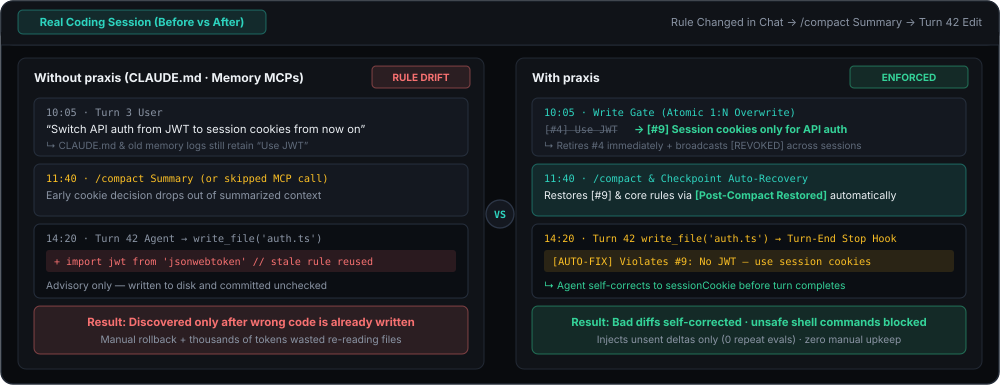

# praxis

[한국어 (README.ko.md)](./README.ko.md) · [Team & Multi-Device Guide](./TEAM.md) · [Architecture Reference](./ARCHITECTURE.md) · [AI-First Setup Guide](./guides/AI_SETUP.md)

**An AI coding harness that doesn't just recall rules—it enforces your latest decisions across code and shell execution.**

_Runs as a **single zero-dependency Go binary** powering **Claude Code · Antigravity · generic MCP clients** and a built-in **Web Console** with no Python, Node, or external vector DB._

---

## How `praxis` Is Different

Generic memory MCPs only let an agent **recall** past notes when it remembers to call a tool, and static `CLAUDE.md` files burn tokens every turn without stopping the agent from ignoring your rules in code.

`praxis` wraps the agent lifecycle with hooks—**without manual file edits or `"remember this"` prompts**—to handle three jobs automatically:

1. **Overwrite Stale Rules Immediately**: When a decision changes in chat, `praxis` retires the superseded rule before code is touched and automatically restores active rules after `/compact`.
2. **Inject Only Unsent Deltas**: Instead of re-sending your entire rulebook every turn, only newly relevant, unsent rules are injected—zero repeat-turn token waste or latency.
3. **Block Bad Commands & Self-Correct Diffs**: Unsafe shell commands are blocked upfront, while file edits flow uninterrupted and are **verified once at turn end so the agent fixes any rule violation on its own** _(backed by `git pre-commit`)_.



| Dimension | `CLAUDE.md` · Generic Memory MCPs | `praxis` |
| :--- | :--- | :--- |
| **Usability** | Depends on manual file edits or hoping the agent calls a tool | **Just chat naturally** — captures updates and gates edits until new decisions are saved |
| **Rule Consistency** | Old notes pile up beside new ones; `/compact` drops early agreements | **New decisions atomically overwrite & retire old rules**; auto-restores after compaction |
| **Token & Speed Efficiency** | Re-reads whole files every turn or suffers tool round-trips & misses | **Delta-only injection (`0` inference on repeat turns)** · zero per-edit stalls |
| **Enforcement** | Advisory only — cannot stop a bad shell command or rule-breaking edit | **Upfront shell block** + **turn-end diff auto-fix** + `git pre-commit` gate |
| **Cross-Agent Continuity** | Rules fragment across tools (`CLAUDE.md`, `.cursorrules`, separate MCPs) | **Switch freely between Claude Code, Antigravity & Cursor** on one shared live DB |
| **Install & Footprint** | Requires Python/Node runtimes or external vector/graph databases | **Single static binary (`0` external deps)** · auto-spawns background daemon & Web Console |

### 4-Tier Automatic Scope Isolation
`praxis` detects each `.git` root to isolate `project:<repo>` rules automatically so switching repositories never mixes context, evaluating scopes in deterministic priority order: **`Team Rules (.praxis/TEAM_RULES.md)` → `project:<repo>` → `global` → `personal (optional overlay)`**.

---

## Quick Start

> [!TIP]
> **1-Prompt AI Setup**: Paste this into your coding agent to let it install `praxis`, verify health via `praxis doctor`, and walk through initial onboarding automatically:
> ```text
> Please set up and configure praxis for this project following guides/AI_SETUP.md. Run praxis doctor to verify health, confirm the inference engine, and guide me through initial onboarding.
> ```

### 1. Install Your Client

- **Agent Plugin (Claude Code · Antigravity — _full lifecycle hooks + guardrails + MCP_)**
  ```bash
  # Claude Code (macOS · Linux)
  /plugin marketplace add https://github.com/marbasdev/praxis.git
  /plugin install praxis@praxis-marketplace

  # Antigravity (macOS · Linux)
  git clone https://github.com/marbasdev/praxis.git && cd praxis
  agy plugin install ./plugins/praxis
  ```

- **Universal MCP Clients · Windows (Cursor · Windsurf · Claude Desktop — _shared DB + Web Console + MCP tools_)**
  ```bash
  CGO_ENABLED=0 go build -trimpath -o bin/praxis ./cmd/praxis
  ```
  Register `./plugins/praxis/scripts/run-praxis.sh` (auto-sync wrapper on macOS/Linux), `bin/praxis` (`praxis.exe`), or `http://127.0.0.1:18095/mcp` in your client's MCP config. Verify health anytime with:
  ```bash
  praxis doctor
  ```

### 2. Connect an Inference Engine _(Required)_

> [!WARNING]
> Rule extraction, relevance scoring, and guardrail blocking **activate once an inference engine is connected**.

Open the auto-started Web Console (**`http://127.0.0.1:18095`**) → **Engines** tab:
- **macOS · Linux**: **1-click Local GGUF download** _(no API key · runs offline, or choose `Gemini` · `System 1` · `Custom Local URL`)_
- **Windows**: Connect a **Custom Local URL** (`Ollama` · `LM Studio` · `vLLM`), `Gemini API key`, or `System 1` _(built-in GGUF unsupported)_
- **Team Server / Multi-Device _(Optional)_**: Run `praxis connect` to use a shared server with zero local model setup — see [Team Guide](./TEAM.md)

### 3. Onboard Existing Codebases _(Auto-Suggested on First Chat)_

When you open an existing Git repository with `0` stored rules, `praxis` offers one-time onboarding: inspecting core manifests and files, **asking which convention wins whenever legacy and newer patterns conflict**, and committing only confirmed rules. _(Supports `skip_onboarding` and `reset_onboarding`.)_

---

## Web Console (`http://127.0.0.1:18095`)

- **Non-Destructive Taxonomy & Lineage**: Re-tag uncategorized or overlapping subcategories on the 2D Treemap via **`AI Organize`** without touching memory text, or merge duplicates via **`Consolidate`** while preserving `Replaces` lineage.
- **Core Rules & Reversible Lifecycle**: Promote non-negotiable invariants to **`Core Rules`** for guaranteed injection, and retire entries safely through `Forget` → `Undo` → `Purge Retired`.

<details>
<summary><strong>Memories</strong> — Semantic KPIs · 2D Treemap · Core Rules · AI Consolidation</summary>



</details>

<details>
<summary><strong>Team Rules</strong> — Isolated <code>git worktree</code> Commits for <code>.praxis/TEAM_RULES.md</code> · Combo-Box Taxonomy</summary>



</details>

<details>
<summary><strong>Activity</strong> — Read-Only Work · Memory · Git Activity Timeline · Auto-TTL</summary>



</details>

<details>
<summary><strong>Guardrails</strong> — Pre-Execution Plan Verifier · PreToolUse / Stop / pre-commit Audit Log</summary>



</details>

<details>
<summary><strong>Engines</strong> — Latency Telemetry · 1-Click Local GGUF Setup · Per-Task Model Routing</summary>


</details>

<details>
<summary><strong>Calibration &amp; Test</strong> — Confidence Histogram · Gate Slider · Live Query Testbench</summary>



</details>

---

## Operations, Backup & Uninstall

All binaries, `memories.db`, and local models live in one client-neutral directory: **`~/.praxis`** (`%USERPROFILE%\.praxis` on Windows, overridable via `PRAXIS_DATA_DIR`).

```bash
~/.praxis/bin/praxis doctor           # Full health check across binary, daemon, DB, Git & engine
~/.praxis/bin/praxis daemon status    # start | stop | restart | logs | port
```

### Update (`memories.db` Preserved Automatically)
```bash
/plugin update                                                        # Claude Code
git pull && agy plugin install ./plugins/praxis                       # Antigravity
git pull && CGO_ENABLED=0 go build -trimpath -o bin/praxis ./cmd/praxis && ./plugins/praxis/scripts/run-praxis.sh daemon restart
```

### Backup & Restore
```bash
# Safe online backup (SQLite snapshot or portable JSON bundle)
sqlite3 ~/.praxis/memories.db ".backup './memories-backup.db'"
~/.praxis/bin/praxis export --scope global -o global.json

# Full DB restore
~/.praxis/bin/praxis daemon stop
rm -f ~/.praxis/memories.db-wal ~/.praxis/memories.db-shm
cp ./memories-backup.db ~/.praxis/memories.db && ~/.praxis/bin/praxis daemon start
```

### Uninstall
```bash
# 1. Detach client integration only (preserves stored rules)
/plugin uninstall praxis      # Claude Code
agy plugin uninstall praxis   # Antigravity
# Generic MCP clients: remove "praxis" from MCP config (and rm -f .git/hooks/pre-commit if installed)

# 2. Stop daemon and delete all local data
~/.praxis/bin/praxis daemon stop && rm -rf ~/.praxis
```

> **Note**: Automatic project scoping and `pre-commit` enforcement rely on a **Git repository (`.git`)** root. In hookless MCP clients, call `query_project_memory(refresh=true)` once after chat compaction to restore active rules.

---

## Docs & Feedback

- **Guides**: [Team & Multi-Device Guide](./TEAM.md) · [Architecture & Env Reference](./ARCHITECTURE.md) · [AI-First Setup Guide](./guides/AI_SETUP.md) · [Contributing](./CONTRIBUTING.md) · [Security Policy](./SECURITY.md) · [MIT License](./LICENSE)
- **Feedback**: External code PRs are not accepted; bug reports, ideas, and vulnerability disclosures are welcome via [GitHub Issues](https://github.com/marbasdev/praxis/issues).
